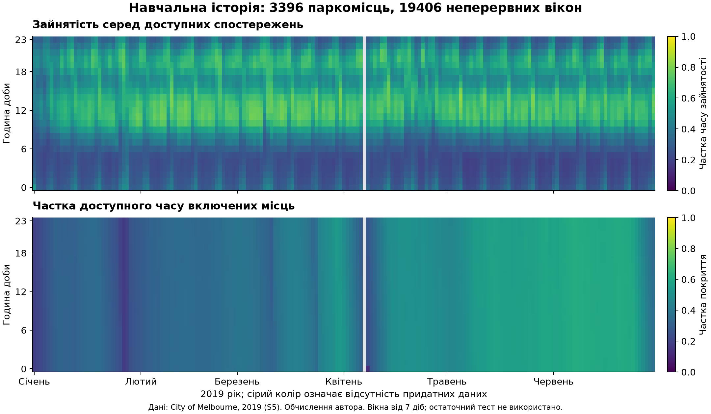
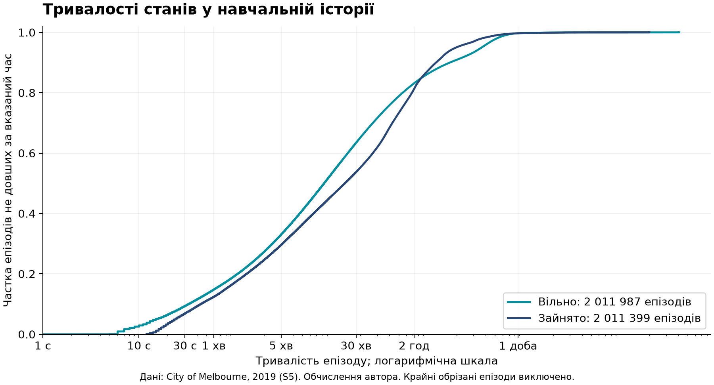

# Фаза 2. Підготовка повного набору даних

Дата: 18.10.2026. **Фаза 2 завершена.** Методи планування на остаточній вибірці не запускалися.

## 1. Результат

Кількість опрацьованих записів - **42 672 743**, паркомісць - **5 013**. Підготовлено неперервні вікна для навчання, налаштування та остаточного порівняння. Основний остаточний тест містить **867 раніше не використаних у пілоті місць**; заданий у протоколі практичний мінімум 20 місць виконано. Це результат підготовки даних, а не підтвердження переваги алгоритму.

## 2. Походження та умови використання

Джерело S5: City of Melbourne, *On-street Car Parking Sensor Data - 2019*. [Офіційна сторінка](https://data.melbourne.vic.gov.au/explore/dataset/on-street-car-parking-sensor-data-2019/information/), [офіційні метадані](https://data.melbourne.vic.gov.au/api/explore/v2.1/catalog/datasets/on-street-car-parking-sensor-data-2019), [архів](https://opendatasoft-s3.s3.amazonaws.com/downloads/archive/7pgd-bdf2.zip). Власні кількості у цьому звіті отримано повним читанням архіву, а не округленим описом на порталі.

Метадані власника вказують **CC BY** та посилання на [CC BY 4.0](https://creativecommons.org/licenses/by/4.0/legalcode). Збережено відповідь API із цими полями. Запис DataVic також отримано через API; його загальна позначка `other-open` менш конкретна, ніж ліцензія власника. У підписах рисунків зазначаємо власника даних та авторство обчислень. Основний портал та його API зараз не містять рядків цієї таблиці, тому використано окремий офіційний архів.

Архів: 717 085 379 байтів. Основний CSV: 7 450 489 331 байтів. Перевірено CRC всіх ZIP-записів, збережено SHA-256 архіву й CSV. Службовий метафайл macOS не вважається таблицею спостережень.

```text
ZIP SHA-256: f8e6bef57dd6228d426ff368c8f632b0f6a4cdbf9dc698e9a94a74450fa43387
CSV SHA-256: 9630417bbaba1876a8a95670008f922c56322f0e6f5687a5f36600e05debc60f
```

Знімки метаданих і сирі дані знаходяться в `.codex-work/parking-research-phase2-20261018/source/`. Ключі наукових джерел і бібліографія: [реєстр](sources.md), [BibTeX](references.bib).

## 3. Перевірка та очищення

- Усі рядки прочитані строгим CSV-парсером із явними подвійними лапками. Поле тривалості може містити кому всередині лапок; рядки з такими значеннями не відкидались.
- Помилок розпізнавання BayId, часових позначок і двійкового стану не виявлено.
- **21 212** інтервалів із нульовою або від'ємною тривалістю виключено. Після цього кількість вхідних інтервалів становить 42 651 531.
- Суміжні й сумісні перекривні записи одного стану об'єднано. Сформовано 35 105 628 однозначних інтервалів стану та 552 940 неперервних ділянок до календарного поділу й фільтру довжини.
- Прогалини та суперечливі перекриття залишено невідомими. Історія через них не продовжується вигаданим станом.
- Дати 07.04.2019 і 06.10.2019 виключено за наперед заданим правилом через відсутність UTC-зсуву. Використовується локальний календар, а не підтверджений UTC.

Кількість сирих додатних рядків тривалістю до хвилини - 9 021 094. **Це не число коротких звільнень**: рядки можуть бути частинами одного стану і спочатку об'єднуються.

### Покриття календарної сітки

Знаменник таблиці - 365 діб для кожного включеного місця, тобто вся календарна сітка 5 013 місць. Час поза першою/останньою подією не називаємо встановленою несправністю датчика.

| Категорія | Місце-діб | Частка календарної сітки |
|---|---:|---:|
| Одночасні суперечливі стани | 2 230.35 | 0.122% |
| Два виключені дні переходу часу | 10 026.00 | 0.548% |
| Прогалини всередині спостереженої історії | 117 421.69 | 6.417% |
| Однозначний записаний стан | 1 448 480.77 | 79.163% |
| Час поза першим/останнім наявним записом місця | 251 586.19 | 13.750% |

Місце-доба означає сумарний час, поділений на 86400 секунд. Однозначні сумісні перекриття не є конфліктами; їхня сумарна тривалість 2 169.88 місце-діб є підмножиною однозначного часу. Не всі такі перекриття автоматично є точними дублікатами рядків.

## 4. Поділ даних

Відбір виконано за [протоколом фази 1](phase1-protocol.md). Усі 166 місць із початкового префікса виключені з остаточного тесту. Додатково перевірено, що всі 250 000 раніше прочитаних рядків збігаються за полями з початком поточного повного CSV.

Нові зарезервовані місця визначено хешем BayId, без перегляду якості роботи алгоритму. Для навчання відведено січень-червень, налаштування - липень-вересень незарезервованих місць, остаточного тесту - жовтень-грудень зарезервованих місць.

Основні вікна від 7 діб:

| Підвибірка | Паркомісць | Вікон | Місце-діб |
|---|---:|---:|---:|
| Пошуковий жовтень-грудень | 3 677 | 12 267 | 188 573.08 |
| Остаточний тест, жовтень-грудень | 867 | 2 904 | 45 939.55 |
| Січень-червень зарезервованих місць | 822 | 4 883 | 67 732.30 |
| Липень-вересень зарезервованих місць, не для налаштування | 806 | 2 929 | 45 707.60 |
| Навчання, місця для розроблення | 3 396 | 19 406 | 265 718.09 |
| Налаштування, місця для розроблення | 3 352 | 12 055 | 181 884.33 |

Кількості місць між рядками не додаються: одне місце може мати історію в різні періоди. Разом основні вікна зберігають 795 554.96 місце-діб, або 54.92% однозначного часу. Додатково збережено коротші вікна від 1 доби для передбаченої перевірки чутливості. У файлах основну вибірку потрібно явно відбирати через `is_primary=true`.

Історія зарезервованих місць за січень-червень відкладена до фіксації навчального конвеєра; липень-вересень цих місць не використовується для налаштування. Остаточні файли відокремлені процедурно; це не шифрування або технічна заборона доступу. Підготовка й перевірка структури інтервалів не є оцінюванням методу на тесті.

## 5. Перші графіки

Графіки побудовано **тільки на основній навчальній підвибірці для розроблення**: 3 396 місць, 19 406 вікон. Остаточні інтервали для цих рисунків не читалися. Це власні обчислення з даних S5.

### Зайнятість і наявність даних



Верхня частина показує зайнятість серед відомого часу, нижня - частку доступного часу включених місць. Невідомі ділянки не підмінені вільним станом. [Векторний SVG](figures/phase2-training-occupancy.svg).

### Тривалості станів



Крайні обрізані епізоди кожного вікна виключено. По горизонталі тривалість, по вертикалі частка епізодів, не довших за неї. Крива описує записані сенсорні стани; вона не встановлює, які звільнення були придатними для водія. [Векторний SVG](figures/phase2-training-durations.svg).

## 6. Перевірка та відтворення

Пройшли вісім контрольних тестів, зокрема порівняння точного проходу з незалежним посекундним підрахунком на випадкових перекриттях. Повний конвеєр додатково перевірено на синтетичному CSV із комою в лапках. Перевірка готових файлів підтвердила контрольні суми, суцільність покриття кожного вікна, відсутність перекриттів, злиття повторів, календарний поділ та правильність резервування місць.

Код і команди: [research/parking_sampling](../../../research/parking_sampling/README.md). Зафіксовані результати підготовки й перевірки: [phase2-data-lock.json](phase2-data-lock.json). Хеші графіків: [реєстр рисунків](figures/phase2-figure-manifest.json). Налаштування застосунку, його сервер і прошивку ця фаза не змінює.

Великі дані залишаються в робочій теці й не додаються до Git. Звіт фіксує походження, кількості й контрольні суми, щоб обчислення можна було повторити.

## 7. Межі висновку та наступна фаза

Даних достатньо для запланованого порівняння за кількістю місць і часовим покриттям. Це ще не оцінка статистичної потужності та не доказ користі кандидата. Обмеження відбору вікон, сенсорного походження станів, одного міста й одного року зберігаються.

Наступна фаза 3: спільний симулятор, регулярні й прості адаптивні правила, відтворення сильного аналога S2, реалізація C0/C1/C2 та зіставлення конкретного правила з близькими роботами. Налаштування відбуватиметься на відведених для цього даних. Порівняльні графіки економії й помилок з'являться після реалізації та перевірки методів.
