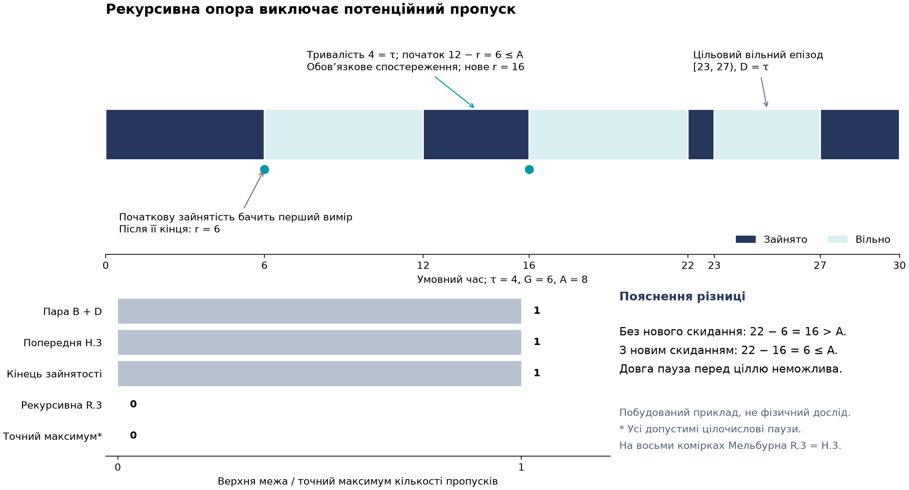

# Перевірка аналітичного кандидата на внесок

25.10.2026. Фаза 3. [План до запуску](phase3-analytic-contribution-plan.json), [метод і доказ](phase3-analytic-method.md), [аналоги](phase3-analytic-sources.md), [коротка постановка для керівника](phase3-supervisor-brief.md).

**Отримано конкретне посилення верхньої межі пропусків.** Опора переноситься на кінець гарантовано поміченої зайнятості; додано послідовне встановлення таких спостережень за віком показів. Це аналітична перевірка класу розкладів на заданій історії. Новий кращий планувальник або підтверджена світова новизна з цього не випливають.

## Незалежна перевірка

Перебрано 2916 випадків із п'ятьма інтервалами тривалістю 1,2,3, двома початковими станами, двома стартами і трьома наборами параметрів. Динамічна програма розглядає кожну дозволену цілочислову паузу, а не тільки C3: 71709 станів і 180201 переходів. У кожному випадку перевірено максимум пропусків, порядок чотирьох меж і незалежний підрахунок за знайденим розкладом. Суперечностей не знайдено.

У цій сітці поліпшення через кінець інтервалу є у 15 випадках; окремого рекурсивного поліпшення немає. Строгість саме рекурсивного кроку показує окремий довший побудований приклад: межі 1,1,1,0 і точний максимум 0. Також наведено приклад, де нова межа 2, а точний максимум лише 1: додатний лічильник не є доказом досяжності. Перевірено ще 200 зафіксовано випадкових шестисегментних прикладів із довільним стартом, зокрема застосовність межі повного вікна до пізнішого старту.

Цілочисловий перебір доповнює письмовий доказ для дійсних часових моментів, а не замінює його. Це не перевірка доказу у формальній системі на кшталт Lean/Coq.

## Незмінені дані та параметри

Використано тільки вже відомі навчальні й перевірочні групи, τ=60 с, G=75 с, A=900 с. Нових правил не налаштовували. Нижче - кількість окремих записаних епізодів, без множення на початкові зсуви. Критерій від доби включає вікна від семи діб; ці рядки не незалежні.

| Комірка | Цільові епізоди | Пара B+D | Попередня H.3 | Кінець інтервалу | Рекурсивна R.3 |
|---|---:|---:|---:|---:|---:|
| training256_primary_7_days | 133491 | 4 | 1 | 1 | 1 |
| training256_sensitivity_1_day | 304236 | 11 | 6 | 6 | 6 |
| tuning128_primary_7_days | 52166 | 5 | 2 | 2 | 2 |
| tuning128_sensitivity_1_day | 97419 | 8 | 4 | 4 | 4 |
| check256_primary_7_days | 101739 | 1 | 0 | 0 | 0 |
| check256_sensitivity_1_day | 192610 | 5 | 2 | 2 | 2 |
| check512_primary_7_days | 186468 | 1 | 0 | 0 | 0 |
| check512_sensitivity_1_day | 344067 | 3 | 1 | 1 | 1 |

Старі лічильники відтворено точно для кожного паркомісця. **На всіх восьми комірках R.3 дорівнює H.3: додаткового емпіричного зменшення немає.** Порівняно з грубою парною межею врахування історії вже давало зменшення; саме новий рекурсивний крок на цих даних нічого додатково не виключив. [Машинні числа](phase3-analytic-counts.csv).

У двох основних перевірочних групах U_R=0: за припущень теореми це підтверджує покриття цільових епізодів для всього класу й довільного початку всередині заданих вікон. На інших рядках додатні межі не гарантують пропусків. Попередній фактичний M60 C3 на налаштовувальних 128 місцях у вікнах від доби збережено; новий результат його не скасовує.

## Що можна стверджувати зараз

Є відтворюваний авторський аналітичний результат із припущеннями, доведенням, строгими прикладами та межами застосування. Відомі загальні ідеї адаптивного планування, мінімальних тривалостей і формальної перевірки відокремлено від конкретного лічильника. Точну достатність цього внеску для магістерської належить обговорити з керівником; не можна підмінити її кількістю тестів.

M60 стосується свіжого виміру всередині епізоду, а F/O - помилкового стану карти. Фізична точність сенсора, енергія та перенесення на майбутню парковку не перевірялися цим аудитом. [Офіційні дані](https://data.melbourne.vic.gov.au/explore/dataset/on-street-car-parking-sensor-data-2019/information/) є сенсорними записами, а не незалежною розміткою реальних автомобілів.

Основний Google-документ і презентації не змінювалися. Остаточні 867 місць не оцінювалися. Фаза 4 залишається закритою до фіксації остаточної заяви про внесок, обґрунтування метрик і повного протоколу. [Окремий журнал технічної перевірки](phase3-analytic-verification.json) зберігає результати тестів і контрольних сум; попередні журнали не переписуються.
