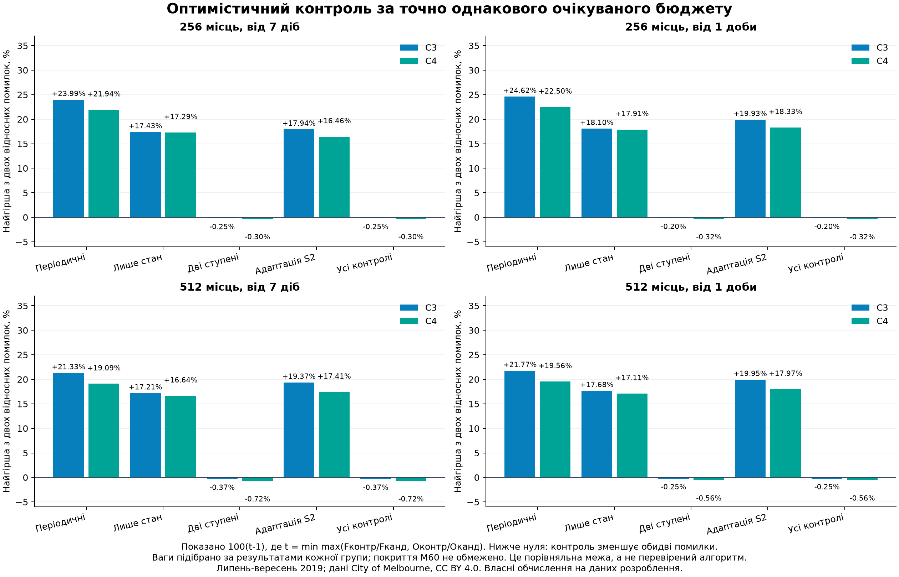
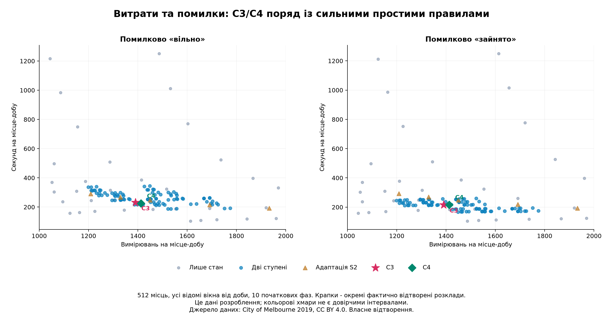

# C3/C4 і сильні прості контролі за однакового бюджету

Дата: 25.10.2026. Фаза3, повторне використання даних розроблення. Це власні експериментальні результати, не остаточний тест.

## Навіщо виконано це порівняння

Попередні порівняння з хвилинним правилом не ізолювали користь історії за однакових витрат. Тут окремо перевірено, чи потрібні додаткові ступені C3/C4 порівняно з простим правилом, яке також враховує час від останньої спостереженої зміни.

У [S1 Lean Sensing](https://kclpure.kcl.ac.uk/ws/portalfiles/portal/51708026/Binder1.pdf) вже розглядають адаптацію паркувальних вимірювань за контекстом і компроміс між витратами та якістю. [S2 Champati та ін.,2022](https://doi.org/10.1109/TCOMM.2022.3160563) оптимізує частоту й штраф за вік для марковського джерела. Загальний принцип адаптації та оптимізація за бюджетом відомі; тут вони є джерельними підставами і контролями, а не заявою про власну новизну.

[План](phase3-budget-comparison-plan.json),269 розкладів і код зафіксовано до запуску. Параметри контролів вибрано на256 навчальних місцях січня-червня та128 місцях налаштування липня-вересня. Після збереження ваг виконано новий порівняльний запуск на вже досліджених групах256/512. Оскільки їхні попередні результати відомі, це не новий незалежний тест. Групи256 і512 не перетинаються; вікна від доби містять вікна від7діб.

## Що порівнювали і як вирівняли ресурс

| Родина | Визначення | Число розкладів |
|---|---|---:|
| Періодичні | Одна пауза після будь-якого показу, від5 до300с | 13, входять до наступних169 |
| Лише останній стан | Окрема постійна пауза після «вільно» та «зайнято» | 169 |
| Просте правило з історією | Дві ступені для кожного стану: коротка пауза спочатку, довша після порога; пороги вільного300/900с, зайнятого300с | 90 |
| Адаптація S2 | Незмінена марковська реалізація з вісьмома номінальними бюджетами | 8 |
| C3/C4 | Незмінені три ступені після «вільно», дві після «зайнято»; довга вільна пауза75/72с | 2 |

Контролям дозволено випадково вибирати один повний розклад на початку відомого вікна, не знаючи його майбутнього. Ваги цього вибору однакові для всіх місць і підібрані на навчанні/налаштуванні. Середні лічильники такої суміші дорівнюють зваженим лічильникам повних розкладів. Це **очікуваний середній ресурс**, а не точна кількість вимірів кожного конкретного пристрою. Дробові M60 у таблицях також є математичним сподіванням суміші.

Ваги добирали мінімізацією найгіршого відношення F/O контролю до кандидата. На кожній із чотирьох комірок навчання/налаштування вимагали не перевищувати кількість вимірів кандидата. Однакова експозиція, початкові фази та перший вимір враховані без поправок за номінальною частотою. Загальне лінійне програмування або така суміш не оголошуються новим алгоритмом.

Дві оцінки чітко розділено:

1. **Зафіксований контроль.** Ваги визначено до поточного запуску перевірочних груп. Перевіряємо перенесення якості й бюджету. Якщо ресурс на перевірці перевищено, це явно показуємо.
2. **Оптимістична межа за точно рівного очікуваного бюджету.** Для кожної перевірочної комірки окремо обрано найкращу суміш за її власними результатами з рівністю кількості вимірів. Вона навмисно має перевагу знання результатів. Це порівняльна межа можливостей заданої родини, а не незалежно перевірений алгоритм, який уже можна встановити на датчик.

S2 використовує раніше зафіксовану січнево-червневу модель4218 місць, тоді як C3 та новий добір простих контролів -256 навчальних місць плюс128 місць налаштування. Відмінність обсягу навчання явно збережена. Початкова ціль S2 - штраф за вік на акт вимірювання, вона не тотожна часу неправильного показу. Навіть гірший результат адаптації S2 тут не спростовує оптимальність статті у її постановці.

## Оптимістичне порівняння за точно однакового очікуваного бюджету

Нижче наведено `t=min max(Fконтр/Fканд,Oконтр/Oканд)`. Значення нижче1 означає: у цій родині існує суміш, яка за точно рівного ресурсу має обидві помилки нижчими. Значення вище1 означає, що одночасно знизити обидві помилки в цій скінченній родині не вдалося; воно не доводить перевагу кандидата за кожною помилкою окремо.

| Група / вікна | Кандидат | Періодичні | Лише стан | Дві ступені | S2 | Усі контролі |
|---|---|---:|---:|---:|---:|---:|
| 256 місць, від 7 діб | C3 | 1.2399 | 1.1743 | 0.9975 | 1.1794 | 0.9975 |
| 256 місць, від 7 діб | C4 | 1.2194 | 1.1729 | 0.9970 | 1.1646 | 0.9970 |
| 256 місць, від 1 доби | C3 | 1.2462 | 1.1810 | 0.9980 | 1.1993 | 0.9980 |
| 256 місць, від 1 доби | C4 | 1.2250 | 1.1791 | 0.9968 | 1.1833 | 0.9968 |
| 512 місць, від 7 діб | C3 | 1.2133 | 1.1721 | 0.9963 | 1.1937 | 0.9963 |
| 512 місць, від 7 діб | C4 | 1.1909 | 1.1664 | 0.9928 | 1.1741 | 0.9928 |
| 512 місць, від 1 доби | C3 | 1.2177 | 1.1768 | 0.9975 | 1.1995 | 0.9975 |
| 512 місць, від 1 доби | C4 | 1.1956 | 1.1711 | 0.9944 | 1.1797 | 0.9944 |

Для двоступеневих контролів найбільше абсолютне відхилення t від1 у цих восьми порівняннях становить 0.72%. Це опис співвідношення спільних помилок, не перевірка статистичної еквівалентності й не допуск, погоджений із користувачами.

## Перенесення зафіксованого простого контролю

Додатне відхилення ресурсу нижче означає, що контроль робить більше вимірів за кандидата; таку пару не можна називати порівнянням із дотриманим однаковим лімітом. F/O подані відносно кандидата, від’ємне значення краще для контролю.

| Група / вікна | Кандидат | Ресурс контролю, % відхилення | F контролю, % відхилення | O контролю, % відхилення |
|---|---|---:|---:|---:|
| 256 місць, від 7 діб | C3 | -0.250 | -0.149 | +0.053 |
| 256 місць, від 7 діб | C4 | -0.249 | -0.271 | +0.009 |
| 256 місць, від 1 доби | C3 | +0.119 | -0.717 | +0.101 |
| 256 місць, від 1 доби | C4 | +0.128 | -0.948 | -0.008 |
| 512 місць, від 7 діб | C3 | -0.437 | -0.267 | +0.149 |
| 512 місць, від 7 діб | C4 | -0.419 | -0.728 | -0.173 |
| 512 місць, від 1 доби | C3 | -0.072 | -0.747 | +0.235 |
| 512 місць, від 1 доби | C4 | -0.049 | -1.159 | -0.079 |

Для цих зафіксованих сумішей виконано2000 парних повторних відборів цілих BayId. Усі фази та вікна одного місця залишаються разом. 95% інтервали є точковими, пошуковими, умовними щодо вже навчених моделей; вони не враховують перенавчання й не мають поправки на всі зіставлення та попередній вибір. Інтервали для оптимістичної межі не видаємо за підтверджувальну статистику.

| Група / вікна | Кандидат | 95% інтервал різниці F, с/місце-добу | 95% інтервал різниці O |
|---|---|---|---|
| 256 місць, від 7 діб | C3 | [-0.789, +1.575] | [-0.673, +0.447] |
| 256 місць, від 7 діб | C4 | [-0.474, +1.714] | [-0.644, +0.581] |
| 256 місць, від 1 доби | C3 | [+0.654, +3.150] | [-0.747, +0.238] |
| 256 місць, від 1 доби | C4 | [+1.184, +3.653] | [-0.555, +0.572] |
| 512 місць, від 7 діб | C3 | [-0.153, +1.196] | [-0.629, +0.078] |
| 512 місць, від 7 діб | C4 | [+0.663, +2.118] | [-0.091, +0.712] |
| 512 місць, від 1 доби | C3 | [+0.979, +2.508] | [-0.830, -0.175] |
| 512 місць, від 1 доби | C4 | [+1.854, +3.423] | [-0.180, +0.500] |

Знак останньої таблиці: кандидат мінус контроль. Додатна різниця означає більше помилок у C3/C4. Для перевірки відповідності бюджету потрібно одночасно читати попередню таблицю ресурсу; сам інтервал якості не вирівнює витрати.

## Ціна близьких помилок відображення: покриття епізодів

Контролі вище оптимізували F/O без обмеження M60, як зафіксовано у плані. Тому близька або краща якість карти не означає виконання всіх початкових критеріїв дослідження. Нижче M60 зафіксованого двоступеневого контролю і відповідного кандидата. Дробові числа - сподівання вибору розкладу; десять початкових фаз включені в лічильник.

| Група / вікна | Кандидат | M60 кандидата | Очікуваний M60 простого контролю |
|---|---|---:|---:|
| 256 місць, від 7 діб | C3 | 0 | 10.102 |
| 256 місць, від 7 діб | C4 | 0 | 3.713 |
| 256 місць, від 1 доби | C3 | 0 | 21.015 |
| 256 місць, від 1 доби | C4 | 0 | 7.681 |
| 512 місць, від 7 діб | C3 | 0 | 21.003 |
| 512 місць, від 7 діб | C4 | 0 | 7.809 |
| 512 місць, від 1 доби | C3 | 0 | 35.822 |
| 512 місць, від 1 доби | C4 | 0 | 14.519 |

Ця різниця не дає права оголосити простий контроль загальним переможцем. Вона також не доводить значущу перевагу карти C3/C4: M60 означає відсутність виміру всередині епізоду, а не його цілковито неправильне відображення. Вимогу свіжого підтвердження кожного звільнення і поріг60с потрібно обґрунтовувати як окрему мету моніторингу, а не приписувати користувачеві або галузевому стандарту.

## Додаткова перевірка з однаковою вимогою покриття

Цей додаток оголошено **після** основного зіставлення, коли виявлено вищий M60 простих контролів. Його пошуковий характер явно зафіксовано в [плані додатка](phase3-budget-coverage-annex-plan.json). Контролям також надали ту саму раніше навчену паузу72с: додано27 постійних за станом і30 двоступеневих правил, загалом326 визначень разом із C3/C4. Кандидати не переналаштовували.

Під час нового добору ваг до тих самих обмежень ресурсу додали `M60контр<=M60канд` у кожній навчальній/налагоджувальній комірці. Ваги збережено перед запуском додаткових контролів на256/512. Окремо знову обчислено оптимістичну межу за рівності очікуваного бюджету та з тим самим обмеженням M60 на перевірочній комірці.

Для розглянутої скінченної родини періодичних правил та адаптацій S2 не знайдено допустимої суміші з таким ресурсом і покриттям. Це результат конкретного банку політик та записів, а не теорема про неможливість будь-якого періодичного або марковського методу. У [технічній версії2](phase3-budget-coverage-annex-v2-plan.json) виправлено лише облік цього допустимого результату «немає розв’язку»; перший незавершений запуск, його код і чотири точні банки лічильників збережено.

| Група / вікна | Кандидат | t, лише стан | t, дві ступені | t, усі допустимі контролі |
|---|---|---:|---:|---:|
| 256 місць, від 7 діб | C3 | 1.1726 | 1.0183 | 1.0183 |
| 256 місць, від 7 діб | C4 | 1.1719 | 1.0010 | 1.0010 |
| 256 місць, від 1 доби | C3 | 1.1795 | 1.0185 | 1.0185 |
| 256 місць, від 1 доби | C4 | 1.1781 | 1.0016 | 1.0016 |
| 512 місць, від 7 діб | C3 | 1.1922 | 1.0169 | 1.0169 |
| 512 місць, від 7 діб | C4 | 1.1818 | 0.9971 | 0.9971 |
| 512 місць, від 1 доби | C3 | 1.1841 | 1.0225 | 1.0225 |
| 512 місць, від 1 доби | C4 | 1.1732 | 1.0087 | 1.0087 |

Значення t має те саме значення, що в основній таблиці, але тепер обмежено також M60, а прості контролі мають доступ до72с. Для C3 оптимістичний двоступеневий контроль має найгірше з двох відношень помилок вище1 на1,69-2,25%. Для C4 перевага непослідовна й мала: значення лежать від0,9971 до1,0087. Ці числа не означають відповідної зміни загальної точності карти у процентних пунктах.

Результат **зафіксованого** двоступеневого контролю наведено нижче. Відхилення - контроль відносно кандидата; M60 є очікуваним числом із десятьма фазами. «Допустимий» перевіряє одночасно ресурс і M60.

| Група / вікна | Кандидат | Ресурс, % | F, % | O, % | M60 контролю | Допустимий |
|---|---|---:|---:|---:|---:|---|
| 256 місць, від 7 діб | C3 | -0.017 | +2.071 | +2.059 | 0.000 | так |
| 256 місць, від 7 діб | C4 | -0.171 | +0.231 | +0.362 | 0.000 | так |
| 256 місць, від 1 доби | C3 | -0.040 | +2.062 | +2.270 | 0.000 | так |
| 256 місць, від 1 доби | C4 | +0.090 | -0.257 | +0.321 | 0.000 | ні |
| 512 місць, від 7 діб | C3 | -0.026 | +2.020 | +1.754 | 0.000 | так |
| 512 місць, від 7 діб | C4 | -0.309 | -0.224 | +0.160 | 0.000 | так |
| 512 місць, від 1 доби | C3 | -0.056 | +2.201 | +2.048 | 0.986 | ні |
| 512 місць, від 1 доби | C4 | -0.051 | -0.425 | +0.248 | 1.680 | ні |

У трьох комірках, де зафіксований простий контроль C3 дотримується ресурсу та M60, C3 має обидві помилки приблизно на2% нижчі. У вікнах від доби групи512 контроль порушує M60. Зафіксований контроль C4 також порушує M60 на512/від доби, а на256/від доби перевищує бюджет. Такі контролі не називаємо загальними переможцями.

95% точкові парні інтервали різниць кандидата мінус контроль для цього додатка:

| Група / вікна | Кандидат | Різниця F, с/місце-добу | Різниця O, с/місце-добу |
|---|---|---|---|
| 256 місць, від 7 діб | C3 | [-5.656, -3.613] | [-4.976, -3.358] |
| 256 місць, від 7 діб | C4 | [-1.310, +0.382] | [-1.371, -0.130] |
| 256 місць, від 1 доби | C3 | [-6.357, -4.374] | [-6.144, -4.463] |
| 256 місць, від 1 доби | C4 | [-0.167, +1.484] | [-1.333, -0.202] |
| 512 місць, від 7 діб | C3 | [-4.631, -3.185] | [-3.646, -2.716] |
| 512 місць, від 7 діб | C4 | [-0.146, +1.018] | [-0.710, +0.121] |
| 512 місць, від 1 доби | C3 | [-5.838, -4.339] | [-4.936, -3.910] |
| 512 місць, від 1 доби | C4 | [+0.435, +1.496] | [-0.895, -0.193] |

Отримано невеликий умовний виграш додаткової ступені C3 за вимоги покриття. Це конкретні власні дані, але їх не можна перетворювати на загальну алгоритмічну новизну. Відому раніше одиницю M60 C3 на128 місцях налаштування/від доби збережено; новий додаток її не скасовує та не повертає C3 як автоматичного переможця початкового протоколу.

Усі значення додатка збережено [в окремому CSV](phase3-budget-coverage-annex-results.csv) та `coverage-annex-v2/results.json`. Оптимістичні межі, зафіксовані контролі й недопустимі задачі розділені. Остаточний тест залишається закритим.

## Обґрунтований висновок для внеску

Порівняння із періодичними та залежними лише від останнього стану правилами показує користь аналізу спостереженої історії в цій задачі. Саму цю ідею вже містить література, тому вона не є достатньою заявою про новизну.

За F/O без обмеження покриття сильний простий контроль із двома ступенями є близьким конкурентом C3/C4, проте його M60 гірший. Додаткова перевірка за однакового M60 виявила невеликий умовний виграш C3. Для C4 істотної послідовної переваги над сильним простим контролем не встановлено. Близькість чисел не доводить еквівалентності; оптимістичний добір за перевірочною групою не є готовим переможним алгоритмом.

Власними результатами залишаються відтворюваний аналіз на відкритій історії, кількісне відокремлення користі історії від складності розкладу та умовна аналітична межа покриття. Це дослідницький матеріал для магістерської, але попередня вимога щодо обґрунтованої новизни ефективнішого алгоритму ще не виконана. Фаза3 залишається відкритою. На підставі цього зіставлення не додаємо ще одну ступінь або нову модель без окремої обґрунтованої гіпотези.

M60 залишено у всіх сирих лічильниках і [повній таблиці](phase3-budget-comparison-results.csv). Попередніх вимог до нього не скасовано. Цей експеримент окремо перевіряє помилки відображення; наукові гарантії не виводяться з одного записаного випадку покриття.

## Відтворення, джерела та обмеження

Джерело даних: [City of Melbourne2019](https://data.melbourne.vic.gov.au/explore/dataset/on-street-car-parking-sensor-data-2019/information/), CC BY4.0, [конвеєр підготовки](phase2-data-report.md). Це сенсорні записи, а не незалежна фізична розмітка автомобілів. Січень-червень і липень-вересень розділені за часом; частина BayId може бути в обох періодах. Жовтень-грудень867 зарезервованих місць та зарезервований липень-вересень не відкривали.

У кожній комірці відтворено всі269 розкладів з однаковими початковими фазами; збережено підсумки кожного BayId, що включають усі його фази й вікна. Для S2 це десять фіксованих випадкових траєкторій на перевірці, а не точне математичне сподівання щодо його внутрішньої випадковості. Сподівання суміші стосується вибору повного розкладу на цих відтвореннях.

Код і дані запуску: `.codex-work/parking-budget-comparison-20261025/`. Ваги добору збережено в `selection-before-check-replay.json`, умови запуску - `pre-fit-lock.json` і `pre-check-lock.json`. У `development-results.json` окремо лежать зафіксовані контролі та оптимістичні межі. Є [план](phase3-budget-comparison-plan.json), [таблиця](phase3-budget-comparison-results.csv), [перевірки](phase3-budget-comparison-verification.json) і [маніфест](phase3-budget-comparison-artifacts.json). Старі результати не перезаписано.

Власні F/O та бюджетний аналіз не є вимірюванням споживання ESP32, точності ультразвуку чи строку роботи батареї. Основний Google-документ, Canva, прошивка та API в цьому досліді не змінювалися.
