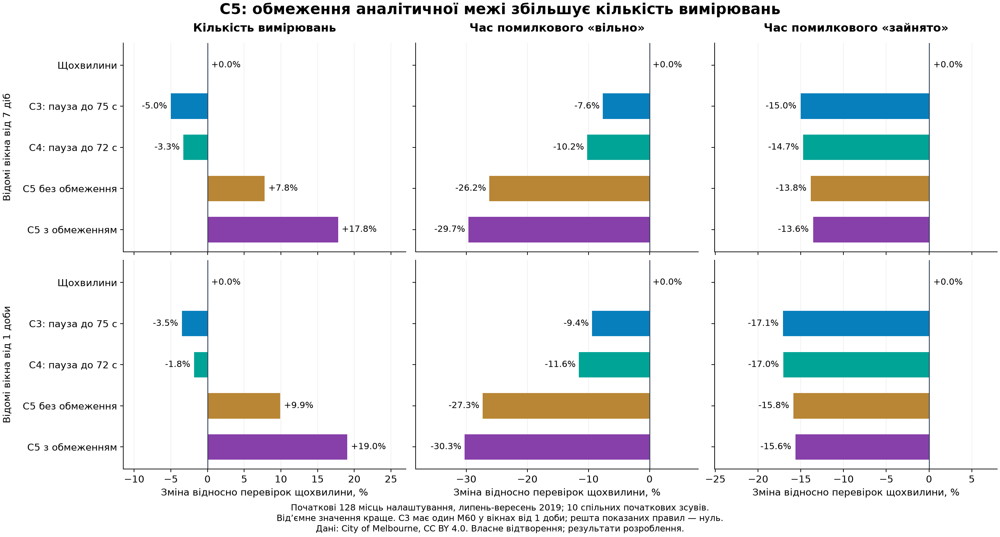
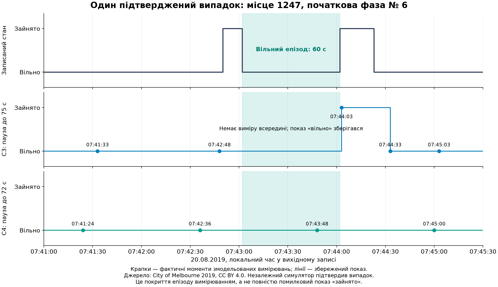

# Конструювання розкладу за межею з урахуванням історії: C5

Дата: 25.10.2026. Фаза 3; усі наведені числа є власними результатами розроблення. Остаточні 867 місць не відкривали.

**Рішення: C5 не приймаємо як поліпшення планування.** Виведена умова дає спосіб побудувати правило з нульовою аналітичною межею на навчальних записах, але в перевіреній родині це потребує більше вимірювань, ніж перевірки щохвилини. Заздалегідь визначений критерій корисності не виконано. Наукову новизну поліпшеного алгоритму не встановлено.

## Що перевіряли

Планування частоти вимірювань та компроміс між витратами й актуальністю вже розглянуто в [S1](https://kclpure.kcl.ac.uk/ws/portalfiles/portal/51708026/Binder1.pdf). Причинне спостереження станів досліджено в [S2](https://doi.org/10.1109/TCOMM.2022.3160563). Неспостережені події між перевірками враховують [S8](https://users.ece.utexas.edu/~gustavo/papers/SBD21.pdf) та [S12](https://link.springer.com/article/10.1186/1687-1499-2013-9). Тому загальну ідею адаптивних пауз або обмеження пропусків авторською новизною не називаємо.

Власна перевірена тут модифікація - перетворення [умови H.1-H.3](phase3-history-bound-method.md) на правило вибору тривалості коротких початкових пауз. [План](phase3-history-scheduler-plan.json) і код зафіксовано до обчислення параметрів. Зіставлення з літературою не доводить відсутності тотожного результату в усіх попередніх працях.

Для довгої паузи G навчальна процедура знаходить усі ризикові пари «коротка зайнятість + вільний епізод від хвилини». За попередніми довгими зайнятостями визначає опору r, яка обмежує можливий початок спостереженої вільної послідовності. Беремо A=max(300,max(p-r)). Якщо довга пауза дозволена лише за спостереженого віку від A, умова p-r>A не виконується для жодної навчальної пари. Це достатня умова на конкретних записах, а не необхідний мінімальний поріг і не гарантія для нових даних.

Під час роботи правило використовує лише отримані покази та час від початку їхньої останньої незмінної послідовності. Справжні неспостережені переходи й навчальна опора r до пристрою не передаються. Калібрування - 256 місць у січні-червні, всі відомі вікна від доби. Перевірка якості - навчальна група і початкові 128 місць налаштування в липні-вересні; окремо вікна від 7 діб і від доби, відповідно 3 та 10 спільних початкових фаз.

Порівняно дві однакові родини: із фільтром аналітичної межі та без нього. Додано простіше правило і незмінені C3/C4/щохвилинний контроль. Усього 44 різні розклади, кожен у чотирьох комірках даних. Після результату жоден параметр не змінювали. Попередні групи перевірки 256/512 і нові місця тут не відкривали.

## Параметри з навчальних даних

| Довга пауза G, с | Пороговий вік A, с | Години | Ризикових пар | Місце, що задає максимум |
|---:|---:|---:|---:|---|
| 75 | 41621 | 11.56 | 11 | 5680 |
| 90 | 61987 | 17.22 | 461 | 5687 |
| 120 | 424725 | 117.98 | 2274 | 8255 |

Великі A виникли через вимогу обнулити достатню верхню межу на всіх навчальних вікнах, включно з рідкісними послідовностями коротких станів. Це консервативність оцінки; вона не означає, що C3 фактично пропустив усі перелічені пари.

## Витрати та якість на початкових 128 місцях налаштування

F - час показу «вільно» за записаної зайнятості; O - час показу «зайнято» за записаної вільності. Їхні одиниці - секунди на місце-добу. M60 - кількість епізодів від хвилини без жодного виміру всередині; повтори за початковими фазами рахуються окремо.

| Вікна | Правило | Вимірів / місце-добу | Скорочення від щохвилинного, % | F | O | M60 |
|---|---|---:|---:|---:|---:|---:|
| від 7 діб | Щохвилини | 1440.03 | 0.00 | 227.90 | 228.08 | 0 |
| від 7 діб | C3/75 | 1368.05 | 5.00 | 210.47 | 193.85 | 0 |
| від 7 діб | C4/72 | 1392.85 | 3.28 | 204.65 | 194.53 | 0 |
| від 7 діб | C5 без фільтра | 1552.29 | -7.80 | 168.13 | 196.55 | 0 |
| від 7 діб | C5 із фільтром | 1696.14 | -17.79 | 160.30 | 197.15 | 0 |
| від доби | Щохвилини | 1440.07 | 0.00 | 282.25 | 282.13 | 0 |
| від доби | C3/75 | 1389.81 | 3.49 | 255.68 | 233.94 | 1 |
| від доби | C4/72 | 1413.66 | 1.83 | 249.58 | 234.03 | 0 |
| від доби | C5 без фільтра | 1582.91 | -9.92 | 205.10 | 237.42 | 0 |
| від доби | C5 із фільтром | 1714.32 | -19.04 | 196.81 | 238.09 | 0 |

Без фільтра вибрано G75/A14400; із фільтром - G75/A41621. Серед відповідних пошукових кандидатів вони мають найменші витрати за однакових обмежень F/O/M60 в усіх чотирьох комірках. **Це діагностичні переможці родини, а не рекомендовані системі правила:** щохвилинний контроль дешевший за обидва. Його не включали до пошукової родини, але явно перевіряли як контроль. C4 також дешевший і проходить усі ці емпіричні обмеження. У простій родині жоден кандидат не пройшов усі чотири комірки; застосовано передбачений щохвилинний контроль.

Порівняно з незміненим C3 аналітичний фільтр додає приблизно 22 процентні пункти витрат у цих комірках. При цьому C3 не проходить нову перевірку M60 на вікнах налаштування від доби. Тому це не порівняння двох однаково допустимих методів і не доказ домінування C3. Вибірка та суворіший фільтр тут відрізняються від первинного добору C3, який використовував основні вікна.

Зменшення F у C5 реальне в межах відтворення, але купується додатковими вимірами. Поставленого поліпшення ресурсу за прийнятної якості воно не дає. Жодна комбінація не пройшла попередньо зафіксовану умову: покращити скорочення вимірів C3 щонайменше на один процентний пункт у всіх чотирьох комірках. Нову перевірочну групу тому не відкривали.

## Новий підтверджений випадок C3 та межі його значення

У початковій групі налаштування знайдено один M60: BayId1247, 20.08.2019, повтор №6, початковий зсув1376с. Запис: зайнято07:42:50-07:43:02 (12с), вільно07:43:02-07:44:02 (60с), сума72с. C3 отримує «вільно» о07:42:48, наступний вимір робить о07:44:03 і не спостерігає хвилинний епізод. У C4 вимір усередині нього є. Незалежний покроковий симулятор підтвердив усі17 підсумкових показників та гістограми для C3, C4 і двох кандидатів C5 на цьому вікні.

Вікно триває603835с - трохи менше7діб (604800с), тому його не було в основному відборі. Це конкретний приклад чутливості до порога відбору вікон. Усі інші правила та параметри залишено зафіксованими; випадок не використовували для їх зміни.

Це **вимірювання всередині епізоду**, а не відновлення цілого вільного епізоду з неправильного показу. C3 весь цей хвилинний інтервал показує «вільно». Неправильний показ «вільно» виникає під час короткої зайнятості перед ним. Один випадок не доводить загальне поліпшення C4 і не скасовує нестійкість калібрування72с.

Попередній перебір57600 відтворень не спростовано: він стосувався інших, неперетинних груп256/512. У них пропусків C3/C4 не знайдено. Тут відкрито ще не відтворену комбінацію старої групи128 і коротших вікон. Не слід узагальнювати жоден результат на всі місця чи всі можливі початки.

## Що це змінює в дослідженні

1. Аналітичну межу можна конструктивно використати для вибору порога; реалізацію перевірено. Вузький аналітичний результат залишається кандидатом внеску з невстановленою світовою оригінальністю.
2. C5 як спосіб зменшення кількості вимірювань відхилено в зафіксованій родині. Не переносимо його в систему і не оголошуємо новим ефективним методом.
3. Для C4 тепер є один конкретний записаний приклад поліпшення покриття відносно C3. Це обмежений емпіричний результат, а не підтвердження вимоги автора щодо сильного нового алгоритму.
4. Детерміноване обнулення достатньої межі не використовуємо як автоматичний напрям подальшого налаштування. Основна задача залишається співвідношенням витрат і помилок відображення. Зміну вимог до M60 потрібно обґрунтувати окремо; цей звіт їх не змінює.
5. Фаза3 відкрита. До фази4 не переходимо, фінальний тест не витрачаємо. Розділи магістерської, Google Docs і Canva цим експериментом не змінювали.

## Відтворюваність і джерела

Дані: [City of Melbourne, On-street car parking sensor data2019](https://data.melbourne.vic.gov.au/explore/dataset/on-street-car-parking-sensor-data-2019/information/), CC BY4.0; [підготовка та маски](phase2-data-report.md). Це записані сенсорні стани, не незалежно перевірена фізична істина. Жодних висновків про точність ультразвуку або строк роботи батареї не робимо.

Файли експерименту: `.codex-work/parking-history-scheduler-20261025/` - pre-fit-lock.json, calibration.json, candidate-lock-before-replay.json, results.json,176файлів метрик, verified-witnesses.json і незалежно перевірений запис. [Повні числові результати](phase3-history-scheduler-results.csv) містять44×4 рядки. [План](phase3-history-scheduler-plan.json), [тести](phase3-history-scheduler-verification.json) та [маніфест](phase3-history-scheduler-artifacts.json) відокремлені від попередніх заморожених матеріалів.

S1/S2/S8/S12 - попередні методи й постановки; формула порога A та наведені числові результати - власна конструкція й обчислення. Прочитаний обсяг джерел і обмеження доступу зафіксовано в [аудиті літератури](phase3-stability-sources.md). Поточний точковий пошук не дав підстав оголошувати світову новизну цього способу побудови.
