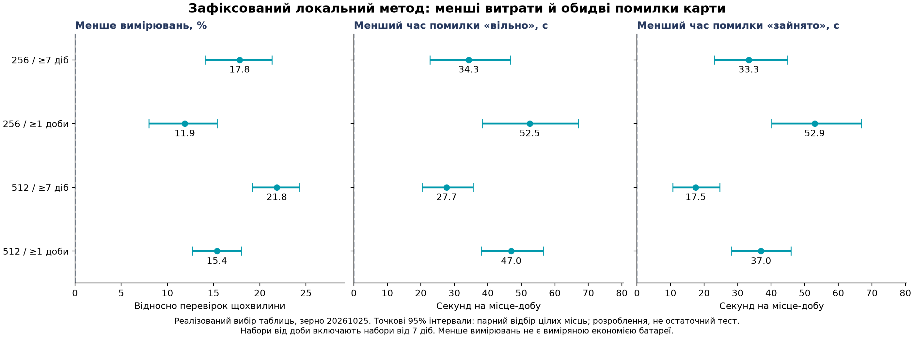
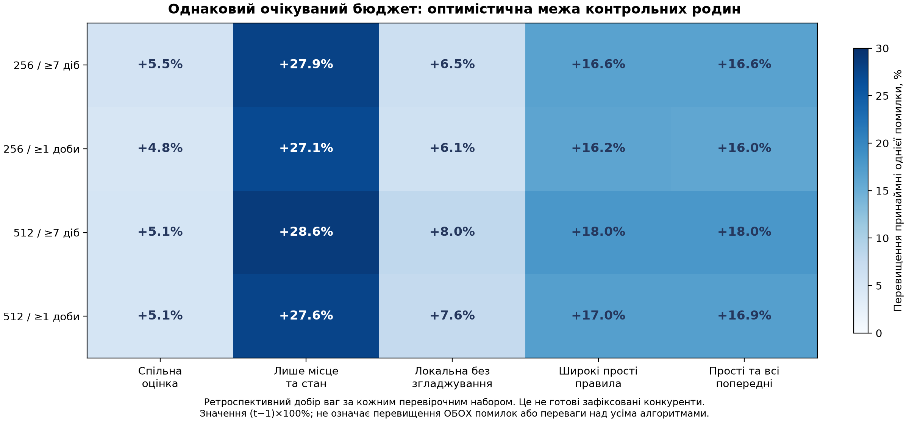
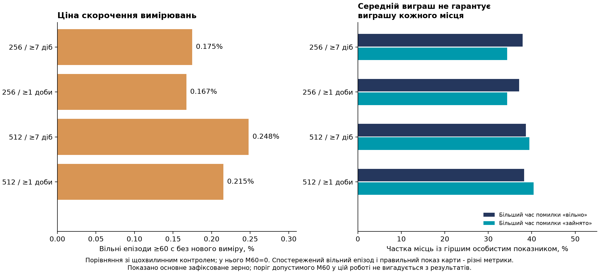

# Практичний результат: локальний ризик і калібрування розкладу

25.10.2026. Дослідницька фаза 3. [Метод L.1-L.6](phase3-local-risk-method.md), [джерела й межі внеску](phase3-local-risk-sources.md), [числа](phase3-local-risk-results.csv).

**Отримано авторський варіант із виміряним виграшем за кількістю вимірювань і двома помилками карти.** Для заздалегідь зафіксованого реалізованого вибору таблиць кількість вимірювань менша на 11.9-21.8%, час помилкового показу «вільно» - на 13.2-18.7%, «зайнято» - на 8.4-18.8% від щохвилинного контролю. Це результати розроблення на вже відомих записах, не незалежне підтвердження на остаточних 867 місцях.

Виграш має ціну: з'являються вільні епізоди від хвилини без нового виміру всередині. Початковий протоколv0.1 із нульовим M60 не виконано; його результати не переписано. Нова постановка щодо якості карти виділена в [окремій чернетці протоколуv0.2](phase4-display-protocol-draft.json), без автоматичного відкриття остаточного тесту.

## Що змінилося в методі

Для кожного місця оцінюємо, скільки секунд карта може помилятися після паузи заданої тривалості. Оцінка враховує виміряний стан, частину доби та спостережену історію. Нестійкі місцеві оцінки підтримуються спільними даними. Потім підбираємо ваги цілих причинних таблиць так, щоб на навчальних/налагоджувальних записах обидва часи помилки не перевищували 90% від щохвилинного контролю. Це інженерний запас, не статистична гарантія.

Для конкретного місця один раз обирається таблиця за наперед фіксованим зерном; далі її інтервали залежать лише від уже зроблених вимірів і часу. Обраний варіант має α=500 та три складники з вагами 0.294067,0.077468,0.628465. Вибір між α50/500 зроблено за навчальною цільовою функцією до нових перевірочних запусків. Повний опис і доведення лінійності сподіваних лічильників наведено у методі.

## Результати для карти та витрат

У таблиці F/O - секунди помилкового показу на місце-добу; наведено «метод / щохвилинний контроль». Критерії від доби та від 7 діб перекриваються, тому чотири рядки не є чотирма незалежними дослідженнями.

| Група / вікна | Вимірів на місце-добу | Скорочення | F: метод / контроль | O: метод / контроль | Вільні епізоди ≥60 с без виміру |
|---|---:|---:|---:|---:|---:|
| 256 / ≥7 діб | 1183.4 | 17.8% | 204.3 / 238.6 | 205.2 / 238.5 | 0.175% |
| 256 / ≥1 доби | 1269.0 | 11.9% | 228.8 / 281.3 | 228.1 / 281.0 | 0.167% |
| 512 / ≥7 діб | 1125.5 | 21.8% | 181.6 / 209.3 | 191.7 / 209.3 | 0.248% |
| 512 / ≥1 доби | 1218.9 | 15.4% | 206.7 / 253.7 | 216.6 / 253.6 | 0.215% |

Це реалізований основний вибір із зерном 20261025. Окреме точне сподівання за обранням таблиці дає скорочення 11.6-22.4%. За всіма десятьма наперед заданими зернами обидва часи помилки менші за щохвилинні в кожному наборі; однак найменше скорочення вимірювань на 256/від доби серед цих зерен дорівнює 9.50%, тому стабільної для кожного зерна нижньої межі 10% не заявляємо. Це не добір сприятливого зерна після результату.

На графіку подано точкові 95% інтервали парного відбору цілих BayId,2000 повторів, умовні щодо вже вибраного методу. Вони не враховують усю історію пошуку й перенавчання, тому не є остаточним підтвердженням або поправленою на всі зіставлення статистикою. У найслабшому ресурсному рядку інтервал скорочення приблизно 8.0-15.4%; число 10% є виконаним критерієм точкової оцінки основного зерна, а не доведеною нижньою межею ефекту.

## Чи це більше, ніж перевага над слабким контролем

Порівняно зі спільною моделлю, моделлю лише місця/стану та локальною без згладжування за однакових даних і сітки дій. Їхні ваги для основних зіставлень добиралися на чотирьох навчальних/налагоджувальних наборах і фіксувалися перед новими запусками. Окремо розширено прості правила до 900 визначень із паузами до 300 с в обох станах; обмежений старий банк не використовуємо як доказ переваги.900 визначень відповідають 841 різній таблиці.

Для точного вирівнювання витрат додатково побудовано **ретроспективні оптимістичні межі**: контрольним вагам дозволено знати результат свого перевірочного набору, а очікувана кількість вимірювань точно дорівнює методу. Нижче - мінімальне неминуче перевищення принаймні однієї з двох помилок у відповідній контрольній родині. Це(t−1)×100%, не обов'язково перевищення обох помилок одночасно.

| Група | Спільна модель | Лише місце/стан | Без згладжування | Прості 900 | Прості й усі попередні 1226 |
|---|---:|---:|---:|---:|---:|
| 256 / ≥7 діб | 5.45% | 27.86% | 6.48% | 16.64% | 16.64% |
| 256 / ≥1 доби | 4.79% | 27.06% | 6.08% | 16.21% | 15.96% |
| 512 / ≥7 діб | 5.15% | 28.59% | 8.04% | 18.01% | 18.01% |
| 512 / ≥1 доби | 5.09% | 27.59% | 7.59% | 16.97% | 16.90% |

Навіть об'єднання 257 спільних, персоналізованих лише за станом і незгладжених визначень у цій оптимістичній перевірці не повторило обидва F/O методу за того самого бюджету. Це конкретний ізольований ефект згладженого локального оцінювання в зафіксованій родині. Він не доводить переваги над усіма можливими алгоритмами або загальної новизни згладжування. Для ретроспективних меж не додаємо довірчих інтервалів як для незалежно обраних політик.

## Ціна виграшу та розподіл між місцями

Основний метод має ненульовий M60, у щохвилинного контролю він нульовий. Частка становить 0.167-0.248% серед вільних епізодів від 60 с з урахуванням десяти початкових фаз. Це не частка часу й не відсоток повністю неправильних показів карти. Допустимий для реального продукту поріг не визначено. За початковим жорстким критерієм нульового M60 поліпшення над щохвилинним правилом не отримано.

Поліпшення середніх не означає виграш кожного місця. Нижче - рівновагові середні за BayId, де кожне місце має однакову вагу, та кількість місць із більшим особистим F/O. Основна таблиця вище використовує погоджене нормування на відому місце-добу.

| Група | Середнє N: метод / контроль | Середнє F | Середнє O | Місць із більшим F | Із більшим O |
|---|---:|---:|---:|---:|---:|
| 256 / ≥7 діб | 1281.3 / 1440.0 | 232.8 / 288.6 | 232.1 / 288.3 | 97 / 256 | 88 / 256 |
| 256 / ≥1 доби | 1282.7 / 1440.1 | 232.9 / 288.5 | 231.7 / 288.3 | 95 / 256 | 88 / 256 |
| 512 / ≥7 діб | 1226.6 / 1440.0 | 206.8 / 254.8 | 216.5 / 254.7 | 198 / 512 | 202 / 512 |
| 512 / ≥1 доби | 1228.7 / 1440.1 | 208.4 / 257.4 | 218.4 / 257.3 | 196 / 512 | 207 / 512 |

Макросередні також поліпшені, але приблизно третина-дві п'ятих місць мають більший окремий F або O. Персональної гарантії або рівномірного поліпшення не заявляємо. На групах 256 і 512 відповідно 11 і 18 місць не мали дозволеної навчальної історії та використовували спільний резервний варіант.

## Відтворення та межі наукового висновку

Навчання:1063 місця, січень-червень 2019, тільки дозволений train_development. Запитані 1098 відомих ідентифікаторів;35 не мали потрібної історії. Використано 30039 відомих навчальних вікон,2948585 інтервалів і 45407244 корельованих навчальних точок. Вибір параметрів - початкові 256/128 місць у чотирьох наборах. Перевірочні 256/512 у липні-вересні вже використовувалися раніше; вони не є новою незалежною вибіркою.

Самодостатню [політику JSON](phase3-local-risk-policy.json) перевірено з окремим онлайн-інтерфейсом, який не бачить майбутніх станів. На 12 відомих вікнах незалежний прямий симулятор відтворив усі 17 лічильників і гістограми затримки. Нові місцеві навчальні історії можна буде додати зі збереженням заморожених спільних оцінок; точну рівність такого способу для наявних 1063 місць перевірено. Зарезервовані історії та остаточні 867 місць у цій роботі не читалися для оцінювання методу.

Первинний вибір однієї таблиці не пройшов власного 10% критерію в усіх наборах. Наступне калібрування оголошено окремим планом після цього результату; незавершену технічну версію 2 і виправлену версію 3 з однаковою математичною постановкою збережено. Початковий протокол, усі невдалі кандидати й раніше отримані аналітичні результати не переписано.

**Обґрунтований внесок для обговорення:** удосконалення конкретного способу планування через L.1-L.6 та виміряний ефект локального згладжування й повного калібрування проти сильних контролів. Це вже власні відтворювані результати, а не перенесені числа зі статті. Загальні складові методу відомі; [зіставлення джерел](phase3-local-risk-sources.md) відокремлює їх від авторської спеціалізації. Світова першість або гарантована оцінка конкретної комісії не встановлюються.

Джерело записів: [City of Melbourne2019](https://data.melbourne.vic.gov.au/explore/dataset/on-street-car-parking-sensor-data-2019/information/), CC BY4.0. Показники стосуються відтворення сенсорної історії, не незалежної фізичної розмітки, точності ультразвуку або виміряного споживання батареї. Основний Google-документ і Canva не змінювалися. [Технічний журнал і контрольні суми](phase3-local-risk-verification.json).
