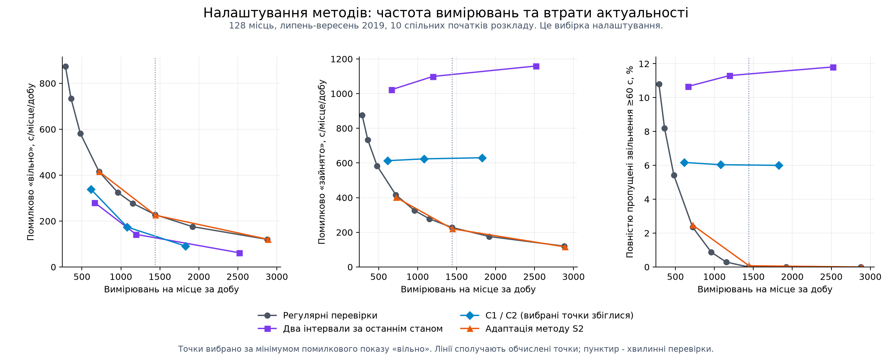

# Фаза 3. Реалізація методів і перевірка на даних для налаштування

Дата: 18.10.2026. Експеримент `phase3-validation-v1`; це **налаштування, не остаточний тест**.

**Код реалізовано й перевірено, але перевага поточного авторського кандидата не підтвердилася.** У зафіксованій сітці C1/C2 не знайшлося конфігурації, яка одночасно не погіршує обидва види неправильного показу й не додає повністю пропущених звільнень тривалістю від 60 секунд відносно регулярної перевірки раз на хвилину. Для основного правила вибору застосовано передбачений запасний варіант: регулярні 60 секунд, нуль заявленого виграшу.

Це не остаточний висновок про весь напрям адаптивних вимірювань. Це негативний результат для конкретного правила, навчання, сітки й вибірки. Він не дає підстав уже писати в магістерській «розроблено покращений метод» або переходити до остаточного тесту з очікуванням наперед відомої переваги.

## 1. Що реалізовано

У [коді дослідження](../../../research/parking_sampling/README.md) є незалежний простий симулятор і прискорений симулятор того самого процесу, навчання табличного правила, регулярні та залежні від останнього стану інтервали, літературний аналог і перевірки його відтворення. На всіх методах інтерфейс утримує останній виміряний стан; між обраними перевірками контролер не отримує поточний записаний стан безкоштовно.

Ідея причинного вибору наступного моменту вимірювання вже представлена у [S2](https://doi.org/10.1109/TCOMM.2022.3160563); наш програмний інтерфейс забезпечує саме таке обмеження доступу, але не є окремою заявою про наукову новизну. Початок нового неперервного вікна скидає історію. Через прогалини та суперечності стан не продовжується.

Код розділено за призначенням: `simulation.py` - еталон і метрики; `kernels.py` - прискорене повторне відтворення; `training.py` - навчальні оцінки; `policies.py` - правила; `markov_baseline.py` - літературна задача; `data_access.py` - дозволені вибірки; `run_phase3.py` - фіксація й запуск. Вебзастосунок і прошивку в цій фазі не змінювали.

## 2. Навчання та дані для налаштування

Джерело - [City of Melbourne, On-street Car Parking Sensor Data - 2019](https://data.melbourne.vic.gov.au/explore/dataset/on-street-car-parking-sensor-data-2019/information/), ліцензія CC BY 4.0 за метаданими власника. Очищення, поділ і обмеження описані у [фазі 2](phase2-data-report.md). Запис сенсора є контрольною історією повторного відтворення, а не незалежною перевіркою фізичної точності.

- Навчання: січень-червень, **4218 місць, 24289 неперервних вікон від 7 діб**. Історію зарезервованих місць за ці місяці відкрито лише після збереження контрольних сум навчального коду. Її однаково використовують авторські правила й оцінювання переходів для S2.
- Навчальні спостереження відтворено за інтервалів 30, 60 і 300 секунд. Цілі обчислювалися раз на 900 секунд, без виходу за межу навчального вікна. Отримано 96,044,271 контекстів-міток на дію з урахуванням трьох розкладів. Це корельовані приклади, не стільки ж незалежних подій.
- Для налаштування до перегляду результатів вибрано **128 місць** за SHA-256 від ідентифікатора. Використано всі їхні **477 вікна від 7 діб у липні-вересні**, по 10 однакових для всіх методів початків розкладу. Вибір підмножини обмежував обчислювальний обсяг; її не добирали за якістю методу.
- Сумарна експозиція - 7,212.26 місце-доби в середньому на початок розкладу. Після об'єднання десяти повторів - 72,122.63 місце-доби-повтори. Повтори не трактуємо як незалежні паркомісця.
- Зарезервовані липень-вересень, пізня пошукова частина та остаточний жовтень-грудень не відкривалися для оцінювання методів. Завантажувач фази 3 відмовляє в доступі до цих станів.

Контрольні суми та список місць збережено у [реєстрі фази 3](phase3-method-lock.json) і локальному `tuning-cohort.json`. Основні вікна від 7 діб покривають лише 54.92% відомого часу очищених даних. Перевірка вікон від 1 доби залишається обов'язковою у фазі 4; нинішні результати її не замінюють.

## 3. Власні кандидати: точний зміст

Контекст складається з останнього виміряного стану, одного з чотирьох шестигодинних проміжків та однієї з шести груп спостережуваної тривалості. Межі останніх: 60, 300, 900, 3600, 14400 секунд. Це час від першого виміру в останній послідовності однакових **виміряних** станів. Він не означає, що фізичний стан увесь цей час не змінювався.

Для кожного з 48 контекстів навчання оцінює наслідки пауз 5, 15, 30, 60, 120, 300 секунд. Позначимо очікувані секунди помилкового показу «вільно» як F(h,d), «зайнято» як O(h,d), а число повністю пропущених звільнень тривалістю від τ - як Mτ(h,d). Навчальні цілі можуть читати наступні 300 секунд **лише навчальної історії**; під час оцінювання вони не доступні контролеру.

**C1** обирає найдовшу паузу з допустимими F/d, O/d та окремими Mτ. **C2** змінює лише останні оцінки на Mτ/d. Пороги τ: 0, 30, 60, 120, 300 секунд. Множники меж для них: 10, 3, 1, 0.5, 0.25. Mτ може бути очікуваним числом кількох епізодів, тому це не ймовірність; Mτ/d має одиницю «епізодів за секунду». F/d та O/d є частками часу.

Оцінки згладжуються 50 псевдоспостереженнями до середнього для останнього стану. Потрібно щонайменше 50 навчальних прикладів у контексті; якщо жодна пауза не проходить, застосовується 5 секунд. Локальні середні оцінки та запасне правило не гарантують обмеження сумарної помилки на іншому періоді.

Варіанти без часу доби, без спостережуваної тривалості та з одним M0/d перевіряють внесок ознак і профілю тривалостей. Історичний C0 взято з незміненої таблиці початкового пілоту. У нього інші навчальні дані й стара гранична мітка пропуску; порівняння C0-C1 **не ізолює** одну алгоритмічну зміну. У новому навчанні епізод, що завершується рівно в момент наступного виміру, правильно вважається пропущеним.

Повна сітка до перегляду цих результатів збережена в [phase3-methods.json](phase3-methods.json): 13 регулярних інтервалів, 156 нерівних пар інтервалів за станом, по 64 конфігурації для п'яти нових варіантів, 25 історичних C0 і 3 S2. Разом **517 конфігурацій**, або **308 відмінних конфігурацій виконання** після точного зіставлення таблиць і параметрів контролера. Однакові конфігурації виконання обчислювалися один раз; усі параметричні конфігурації збережені.

## 4. Літературний аналог і перевірка відтворення

Для [Champati та ін., S2](https://doi.org/10.1109/TCOMM.2022.3160563) реалізовано лінійну програму за мірами зайнятості стан-дiя з додатка B, формули (24)-(27). Для стану j й паузи τ використовуємо їхню вартість c_j(τ) = Σ від n=1 до τ-1 [(τ-n)(1-p_jj)p_jj^(n-1)]. Це критерій на момент спостереження, а не наші секунди помилкового показу за добу. У коді матриця переходів має рядки, сума яких дорівнює одиниці.

У синтетичному прикладі 1 отримано **1.415787269**, що збігається з округленим 1.416 у статті. Підтверджено паузи 6/7 у першому стані, 2 у другому та вагу паузи 7 близько 0.535. Для прикладу 2 оптимізатор виконує обмеження d=1 і дає частоту, яка округлюється до 0.14.

Водночас надруковані в поясненні прикладу 2 ваги 0.64/0.36 для пауз 7/8 та пауза 2 в іншому стані за наведеними рівняннями дають вартість 1.069077, вищу за 1. Цю неузгодженість явно збережено у протоколі перевірки; код не підганявся під надруковані ваги. Відтворено рівняння і перший приклад, не весь авторський програмний пакет.

Для паркувальних даних це **адаптація S2**: крок 5 секунд, 13 допустимих пауз, матриця для кожного місця оцінюється за його навчальною історією зі згладжуванням 50 псевдопереходами до загальної матриці. Якщо власної історії немає, береться загальна матриця. Цільові частоти - 720, 1440, 2880 за добу. Стаціонарне модельне обмеження не гарантує точно таку частоту на реальній відкладеній історії; показуємо фактичну.

## 5. Перевірки правильності

**Пройшли 30 перевірок**, помилок і пропусків немає. [Повний протокол](phase3-verification.json). Вони охоплюють очищення прогалин і конфліктів, часові межі, ручний приклад обох помилок, відсутність подій, обрізані крайні епізоди, навчальні мітки й недоступність майбутніх станів контролеру. Прискорений симулятор зіставлено з незалежним простим симулятором на 100 випадкових історіях для кожного з трьох класів правил, включно з випадковим S2. Збігаються всі лічильники та гістограма затримок.

Окремо перевірено нормування, вилучення ознак, обмеження лінійної програми та правило вибору. Перший і останній епізоди вікна не використовуються як повні звільнення. Для інтервалу [a,b) вимір у b вже не виявляє цей епізод. Для всіх конфігурацій експозиція, вікна та початки розкладу однакові.

## 6. Що показало налаштування

Позначення: F - помилково «вільно», O - помилково «зайнято»; одиниця для них - секунди на місце за добу. M60 - частка повністю пропущених звільнень тривалістю від 60 секунд. Нижче наведено власні обчислення `phase3-validation-v1` з даних S5, не числа зі статей.

| Конфігурація | Вимірів/місце/добу | F | O | M60 |
|---|---:|---:|---:|---:|
| Регулярно, 60 с | 1440.03 | 227.90 | 228.08 | 0.0000% |
| C1 і C2, точка бюджету 1440 | 1081.19 | 174.06 | 623.79 | 6.0399% |
| Два інтервали за станом, точка бюджету 1440 | 1193.84 | 142.25 | 1098.87 | 11.3016% |
| S2, номінально 1440 | 1444.75 | 225.40 | 220.26 | 0.0733% |

Точка C1/C2 використовує на **24.92%** менше перевірок. Але O зростає з 228.08 до 623.79 с/добу, і з'являються повністю пропущені звільнення від 60 секунд. Цей результат **не проходить основну умову якості**. Показувати лише економію перевірок було б оманливо.

Основний наперед заданий відбір вимагає F ≤ F60, O ≤ O60, M60 ≤ M60_60; далі мінімізує число вимірів. Перевірка порівнює цілі лічильники на спільній експозиції без похибки округлення. У регулярних 60 секунд M60 дорівнює нулю, тому жоден додатковий пропуск не допускається.

| Родина | Конфігурацій, що виконують усі умови | Обрана конфігурація або запасна | Зменшення числа вимірів |
|---|---:|---|---:|
| fixed | 7 | fixed_60 | 0.00% |
| state | 37 | fixed_60 | 0.00% |
| S2 | 1 | S2_2880 | -100.64% |
| C0 | 0 | fixed_60 | 0.00% |
| C1 | 0 | fixed_60 | 0.00% |
| C2 | 0 | fixed_60 | 0.00% |
| C2_no_duration | 0 | fixed_60 | 0.00% |
| C2_no_time | 0 | fixed_60 | 0.00% |
| C2_no_run | 0 | fixed_60 | 0.00% |

Від'ємне «зменшення» означає **більше** перевірок. Для C0/C1/C2 та вилучених складових запасна `fixed_60` не є авторським методом. Перевірка складових поки не доводить користі нормування чи профілю тривалостей: вибрані ресурсні точки C1 і C2 навіть збіглися за розкладами.

Для M60 знаменник 520,023 - це **епізоди-повтори** за десятьма початками, не стільки ж різних фізичних звільнень. У CSV є всі пороги й знаменники. Затримка обчислена тільки для виявлених епізодів; вона не замінює частку пропусків. Довірчі інтервали й остаточні порівняння за місцями ще не виконані.

Джерело даних: [City of Melbourne, S5](https://data.melbourne.vic.gov.au/explore/dataset/on-street-car-parking-sensor-data-2019/information/); повторне відтворення й рисунок авторські. [SVG](figures/phase3-validation-tradeoffs.svg), [точки рисунка та інших варіантів](phase3-validation-points.csv), [усі 517 конфігурацій](phase3-candidate-results.csv). Лінії лише сполучають фактично обчислені точки.

**Уточнення другорядного ресурсного зіставлення.** Після першого перегляду налаштування виявлено, що через обов'язковий перший вимір у кожному вікні регулярні 60 секунд дають 1440.032189, а не рівно 1440 перевірок/добу. Буквальна межа 1440 відкидала власну базову точку. Тому для емпіричних правил ресурсну межу зіставлено з фактичною частотою відповідного регулярного правила. S2 збережено у власній номінальній точці з явно показаним перевищенням. Порядок «F, O, M60, число вимірів» не змінено. Це позначена зміна **після налаштування, до остаточного тесту**; основний строгий відбір і сітку не змінювали. [Причина і точне правило](phase3-resource-selection.json). Первісний варіант теж збережено для аудиту.

## 7. Що є відомим, а що залишається кандидатом на внесок

| Складова | Найближче перевірене джерело | Межа нашої відмінності |
|---|---|---|
| Частота проти якості та контекст парковки | [S1](https://kclpure.kcl.ac.uk/ws/portalfiles/portal/51708026/Binder1.pdf), рис. 7, 9-10 | Інші критерії й правило; сам компроміс уже відомий. |
| Вибір наступного оплаченого спостереження | [S2](https://doi.org/10.1109/TCOMM.2022.3160563), §II та додаток B | Наше правило емпіричне й не розв'язує їхню марковську задачу оптимально. |
| Часткова спостережуваність та різна ціна помилок | [S3](https://liu.diva-portal.org/smash/get/diva2%3A1997077/FULLTEXT01.pdf), §III; [S6](https://arxiv.org/abs/2610.22265) | Використовуємо утримання останнього виміру та власні метрики; загальна постановка не нова. |
| Тривалості станів і історія | [S4](https://arxiv.org/abs/2106.06197); [S7](https://anrg.usc.edu/www/papers/WangKrishnamachariAnnavaram_SECON2012.pdf), §III-IV | Спостережувана послідовність однакових вимірів не дорівнює відомому фізичному віку стану. |
| Цілком пропущені події, нормування за часом, вплив тривалостей | [S8](https://users.ece.utexas.edu/~gustavo/papers/SBD21.pdf), §II-III, V-A | Наші контексти реагують на виміри; у S8 розклад незалежний від реалізації подій. Сам облік пропусків уже відомий. |
| Адаптивна частота саме паркувального сенсора за історією | [S9](https://patents.google.com/patent/DE102015211054A1/en), опис і пункт 1 | Публікація раніше описує цю загальну технічну ідею; вона не містить нашого проведеного порівняння. |

**Кандидат на власну модифікацію** - конкретний вибір паузи за спільними емпіричними оцінками F/d, O/d і профілем Mτ/d, отриманими з доступних спостережуваних контекстів. У перевірених джерелах не встановлено тотожного правила, але пошук не доводить його світову новизну. Корисність цієї конструкції в нинішній реалізації теж не встановлено. Не можна називати новизною просте складання відомих ознак або саме використання чужого набору даних.

## 8. Обмеження та рішення перед наступною фазою

Поточне правило об'єднує різні місця в одну таблицю ризиків; S2 має індивідуальні оцінки переходів. Порівняння тому не ізолює тільки форму математичного критерію. Навчальні контексти походять від трьох регулярних розкладів, а робочий адаптивний розклад створює іншу частоту їх відвідування. Локальні оцінки ризиків не є гарантією підсумкових F/O/M60. Це можливі напрями діагностики, а не вже доведені причини невдачі.

Нуль пропусків M60 у хвилинного розкладу задає сувору умову. За паузи понад 60 секунд між вимірами теоретично може повністю вміститися звільнення такої тривалості. Історія може зробити його менш очікуваним, але не дає універсальної гарантії його відсутності. Ця властивість випливає з постановки, не є новою теоремою про сенсор.

**Фаза 3 завершена як реалізація й перевірка початкового кандидата. Підтвердження покращення не отримано.** Зафіксовані таблиці дозволяють відтворити негативний результат та ресурсні компроміси. До відкриття остаточного тесту доцільно доопрацювати правило в межах цього самого напряму, окремо реєструючи нову версію та її налаштування, або погодити з керівником порівняльний характер роботи. Не варто витрачати незалежний остаточний тест на те, щоб замаскувати відомий провал вибору.

Наступна технічна задача для доопрацювання - перевірити, чи можна перейти від локальних порогів до явного контролю компромісу всього розкладу, і чи дає це перевагу над простими інтервалами та S2 на решті даних для розроблення. Це ще завдання, а не обіцянка успіху. Після фіксації прийнятного кандидата фаза 4 включатиме остаточний тест, перевірку вікон від 1 доби, розкид між місцями, парні інтервали невизначеності та основні графіки для захисту.

Точність HC-SR04 під автомобілем, енергоспоживання ESP32, надійність мережі та строк служби батареї тут не вимірювалися. Основний Google-документ і презентації не змінювалися. [Реєстр зафіксованих методів](phase3-method-lock.json), [перевірки](phase3-verification.json), [джерела](sources.md).
