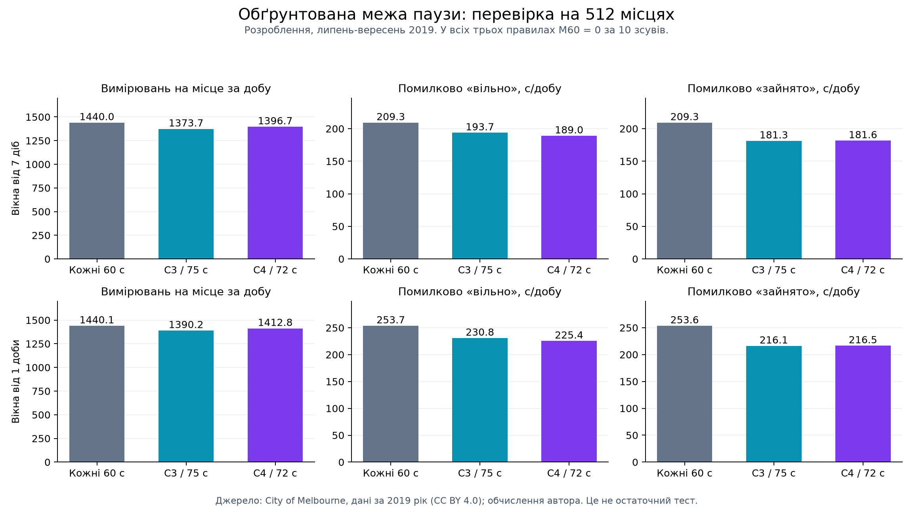
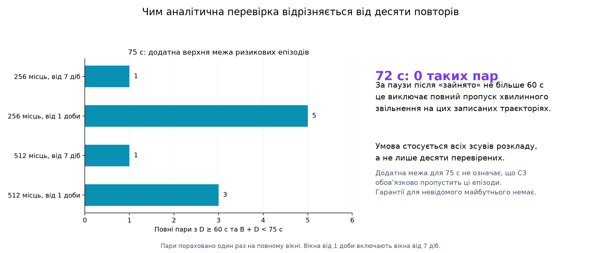

# Фаза 3: перевірка авторського внеску й правило C4

Дата: 25.10.2026. Ідентифікатор: `phase3-novelty-audit-20261025`. Основний Google-документ і презентації не змінювалися.

**Результат:** додаткове обмеження на пропуски саме по собі не пояснило перевагу C3. Натомість отримано окреме аналітичне обґрунтування максимальної паузи та реалізовано C4, де довга пауза визначається за навчальними парами тривалостей. Воно дає меншу економію вимірів, але для перевірених траєкторій - сильніше обґрунтування відсутності хвилинних пропусків. Світову новизну та перевагу над усіма аналогами не встановлено. **Фаза 4 поки закрита.**

## 1. Контрольна перевірка початкової претензії

До запуску зафіксовано [план](phase3-novelty-audit-plan.json): однакові 256 навчальних місць, початкове хвилинне правило, 12 ефективних груп стану/спостереженої тривалості, множина дій, дві ітерації пошуку, сітка ваг та правила вибору. Відрізнялося лише обмеження:

1. Тільки дві тривалості помилкового показу F/O.
2. Додатково загальна кількість повністю пропущених звільнень M0 не більша за хвилинне правило.
3. Додатково кількість повністю пропущених звільнень від хвилини M60 не більша за хвилинне правило, тобто нуль.

Для кожної групи отримано 27 конфігурацій, разом 81; кеш містить 1625 різних навчальних відтворень. Захищений варіант точно відтворив попередні таблиці C3 для всіх 27 конфігурацій. **Усі три групи обрали одну й ту саму таблицю.** Їхні результати на нових 256 місцях збігаються до сирих лічильників. Умову успіху «менше M60, ніж у двох контролів» не виконано.

Отже, значущість самого показника тривалості події не означає, що обмеження реально змінило обрану політику. Побудовано також синтетичний приклад: дві історії з однаковими спостереженнями, F/O, чотирма переходами та двома загальними пропусками, але з різним M60. Він доводить відмінність критеріїв, проте не доводить ефекту нашого обмеження на реальних даних.

## 2. Що саме додано в C4

Отримано необхідну умову: якщо після «зайнято» пауза не перевищує 60 с, для повного пропуску вільного епізоду від хвилини сума його тривалості D та безпосередньо попередньої зайнятості B повинна бути меншою за максимальну паузу G після «вільно»:

```text
Повний пропуск D >= 60 с  =>  B + D < G.
```

Кількість таких пар є верхньою межею кількості пропусків на конкретній траєкторії. Якщо пар немає, пропуск виключено для всіх розкладів, що дотримуються меж пауз. [Повні припущення, доведення, формули та причинне правило C4](phase3-pair-envelope-method.md).

У 132840 навчальних пар мінімальна сума дорівнює 72 с. За зафіксованим до навчання правилом `G=min(120, min(B+D))` отримано **72 с**. У C3 замінено тільки довгу вільну паузу 75 на 72 с; початкові 30/45 с і зайняті 30/60 с залишилися однаковими. Підбору G за липнем-вереснем не було. Довга пауза застосовується після 900 с однакових спостережених показів «вільно»; це не відомий справжній вік вільного стану.

Це авторська модифікація з конкретним виведенням, а не нова назва колишньої таблиці. Але сама простота виведення чи відмінність реалізації ще не доводить наукової новизни. [Матриця найближчих джерел і точні межі прочитання](phase3-novelty-sources.md).

## 3. Межі перевірки

Після первинної контрольної перевірки **256 місць уже стали даними розроблення**. C4 перевіряється на раніше відомих групах 128/256/512; жодну з них не називаємо новим остаточним сліпим тестом. Нові 256 не перетинаються з попередніми 128/512 та 166 місцями старого префікса. 256 і 512 взаємно не перетинаються, разом це 768 перевірочних BayId. Із навчальними 256 BayId збігаються відповідно 15 та 32 місць, але навчання - січень-червень, перевірка - липень-вересень. Отже, ці результати не є повною перевіркою перенесення на невідомі місця.

Використано 10 однакових початкових зсувів для всіх правил. Вікна від 1 доби включають основні вікна від 7 діб, тому це перевірка чутливості, а не незалежний другий експеримент. М60 у таблицях - **кількість пар «епізод-зсув»**, а не кількість незалежних фізичних подій. Обидві помилки та кількість вимірів нормовані на спільний час відтворення.

F - час, коли показано «вільно», а записано «зайнято»; O - зворотна помилка. Джерело траєкторій: [City of Melbourne, 2019](https://data.melbourne.vic.gov.au/explore/dataset/on-street-car-parking-sensor-data-2019/information/), CC BY 4.0. Підготовка й прогалини описані у [фазі 2](phase2-data-report.md). Записані сенсорні стани не є незалежною фізичною розміткою.

## 4. Числові результати

### Група 256 місць

| Вікна | Правило | Вимірів/добу | Менше вимірів | F, с/добу | O, с/добу | M60 | Умови якості |
|---|---|---:|---:|---:|---:|---:|---|
| Від 7 діб | fixed60 | 1440.03 | 0.00% | 238.59 | 238.54 | 0 | так |
| Від 7 діб | C3_75 | 1377.48 | 4.34% | 222.34 | 201.53 | 0 | так |
| Від 7 діб | C4_72 | 1401.44 | 2.68% | 216.45 | 201.37 | 0 | так |
| Від 7 діб | simple75 | 1323.31 | 8.11% | 238.78 | 238.25 | 0 | ні |
| Від 7 діб | simple72 | 1347.26 | 6.44% | 232.87 | 238.88 | 0 | ні |
| Від 7 діб | state_only72 | 1307.57 | 9.20% | 285.20 | 234.02 | 0 | ні |
| Від 1 доби | fixed60 | 1440.08 | 0.00% | 281.34 | 281.00 | 0 | так |
| Від 1 доби | C3_75 | 1394.29 | 3.18% | 258.33 | 233.21 | 0 | так |
| Від 1 доби | C4_72 | 1417.58 | 1.56% | 251.90 | 233.25 | 0 | так |
| Від 1 доби | simple75 | 1331.65 | 7.53% | 278.44 | 280.69 | 0 | так |
| Від 1 доби | simple72 | 1354.91 | 5.91% | 271.93 | 281.82 | 0 | ні |
| Від 1 доби | state_only72 | 1309.27 | 9.08% | 335.31 | 274.64 | 0 | ні |

### Група 512 місць

| Вікна | Правило | Вимірів/добу | Менше вимірів | F, с/добу | O, с/добу | M60 | Умови якості |
|---|---|---:|---:|---:|---:|---:|---|
| Від 7 діб | fixed60 | 1440.03 | 0.00% | 209.29 | 209.25 | 0 | так |
| Від 7 діб | C3_75 | 1373.66 | 4.61% | 193.72 | 181.28 | 0 | так |
| Від 7 діб | C4_72 | 1396.73 | 3.01% | 189.04 | 181.56 | 0 | так |
| Від 7 діб | simple75 | 1325.25 | 7.97% | 208.71 | 208.42 | 0 | так |
| Від 7 діб | simple72 | 1348.32 | 6.37% | 203.94 | 208.85 | 0 | так |
| Від 7 діб | state_only72 | 1313.70 | 8.77% | 250.50 | 206.18 | 0 | ні |
| Від 1 доби | fixed60 | 1440.07 | 0.00% | 253.71 | 253.58 | 0 | так |
| Від 1 доби | C3_75 | 1390.18 | 3.46% | 230.83 | 216.15 | 0 | так |
| Від 1 доби | C4_72 | 1412.76 | 1.90% | 225.41 | 216.50 | 0 | так |
| Від 1 доби | simple75 | 1332.38 | 7.48% | 249.81 | 253.23 | 0 | так |
| Від 1 доби | simple72 | 1354.96 | 5.91% | 244.43 | 253.76 | 0 | ні |
| Від 1 доби | state_only72 | 1314.04 | 8.75% | 303.29 | 249.25 | 0 | ні |



На всіх чотирьох поєднаннях групи й тривалості вікна C4 виконав початкові умови F/O/M60 і зменшив число перевірок порівняно з хвилинним правилом. **Скорочення становить 1.56-3.01%.** C3/75 економить більше вимірів. C4 не домінує над ним за всіма помилками: зокрема, O на 512 місцях трохи більша за O C3, хоча нижча за хвилинне правило.

Окремо за [заздалегідь записаним планом контролів](phase3-pair-envelope-controls-plan.json) перевірено простіші правила. `simple75` - раніше обране нарощування: після «вільно» 45 с до 900 с однакових показів, потім 75 с; після «зайнято» завжди 60 с. `simple72` змінює тільки 75 на ту саму навчальну межу 72 с. `state_only72` завжди чекає 72 с після «вільно» й 60 с після «зайнято».

Стале правило дає найбільшу економію, але помилка F приблизно на 19% більша за хвилинне правило. Просте нарощування з межею 72 с економить 5.91-6.44%, проте не виконує точну умову O на трьох із чотирьох перевірок. Перевищення мале: приблизно 0.17-0.82 с/місце/добу. Це **не встановлення статистично значущої шкоди**: парні інтервали збережено разом з усіма іншими й потребують відповідної інтерпретації. На нових 256 основних місцях початкове `simple75` теж трохи порушило F. Отже, складніший C4 залишаємо як варіант із більшим запасом щодо помилок, а прості правила - як обов'язкові конкуренти. Висновок «C4 кращий за всі прості правила» був би неправдивим.

Орієнтовні 95% парні інтервали для C4 проти хвилинного правила, 2000 повторних вибірок **місць**, зі збереженням усіх їхніх вікон і зсувів:

- 256 місць, від 7 діб: скорочення вимірів [1.96, 3.35]%; різниця F [-27.64, -17.10]; різниця O [-42.52, -32.44] с/місце/добу.
- 256 місць, від 1 доби: скорочення вимірів [0.82, 2.26]%; різниця F [-35.56, -23.80]; різниця O [-54.14, -41.83] с/місце/добу.
- 512 місць, від 7 діб: скорочення вимірів [2.52, 3.44]%; різниця F [-23.41, -17.32]; різниця O [-30.55, -25.09] с/місце/добу.
- 512 місць, від 1 доби: скорочення вимірів [1.39, 2.36]%; різниця F [-32.32, -24.65]; різниця O [-40.65, -33.56] с/місце/добу.

Це оцінка розкиду між місцями на даних розроблення. Вона не враховує всю залежність між сусідніми місцями та спільними датами й не дає гарантії нульового ризику майбутніх подій. Повні інтервали C4 проти C3 збережено окремо.

## 5. Що додала аналітична перевірка

Для цього лічильника кожне повне вікно розглядається один раз, без множення на десять зсувів:

| Місць | Вікна | Пар з D>=60 та B+D<75 | Пар з D>=60 та B+D<72 |
|---:|---|---:|---:|
| 256 | Від 7 діб | 1 | 0 |
| 256 | Від 1 доби | 5 | 0 |
| 512 | Від 7 діб | 1 | 0 |
| 512 | Від 1 доби | 3 | 0 |



Для 72 с отримано нуль на всіх повних вікнах цих двох груп. За доведеним твердженням це виключає хвилинні пропуски **на цих записах** для будь-якого початкового зсуву політики з відповідними межами. Для 75 с теорема залишає ненульову верхню межу. Це не доказ того, що конкретний C3 обов'язково реалізує хоча б один із цих пропусків.

Початкова груба межа за однією короткою зайнятістю була значно слабшою: наприклад, для 256 місць/7 діб давала 10346 пар «епізод-зсув» проти 10 у межі за сумою. Уточнення відсікає довгі вільні епізоди, які фізично не вміщаються в паузу. Межа може залишатися консервативною; вона не прогнозує фактичну кількість пропусків.

## 6. Що можна захищати, а що залишається відкритим

Маємо власний аналітичний результат, його реалізацію та кероване порівняння зміни тільки одного елемента розкладу. Для формулювання внеску пропонується [вузький опис у записці C4](phase3-pair-envelope-method.md), який не приписує автору винахід адаптивного опитування.

Поки не встановлено: світову новизну цієї конструкції; перевагу над найближчими методами за однаковою вимогою до гарантованої межі; стійкість калібрування до зміни періоду, часових похибок та рідкісних записів. Мінімум 72 с з навчання не є законом поведінки всіх машин. Збереження умови на даних липня-вересня - результат перевірки, а не доказ її збереження назавжди.

Тому [умову входу у фазу 4](phase3-novelty-gate.json) не відкрито. Наступне вузьке завдання фази 3 - завершити зіставлення саме доведеної умови й калібрування з найближчою літературою та оцінити стійкість навчального мінімуму. Перевірка простіших контролів уже виконана; її не переносимо мовчки на майбутнє. Остаточні 867 місць не оцінювалися. Значного переписування магістерської зараз не потрібно.

## 7. Відтворення і перевірки

Пройшли **59 перевірок**, включно з незалежним симулятором, граничними моментами, однаковими майбутньо-незалежними рішеннями, контрольним втручанням в обмеження, випадковими та вичерпними короткими траєкторіями для двох аналітичних меж. [Протокол перевірок](phase3-novelty-verification.json).

Основні команди з кореня репозиторію після встановлення наявних залежностей дослідження:

```powershell
python research/parking_sampling/audit_episode_constraint.py
python research/parking_sampling/assess_cycle_certificate.py
python research/parking_sampling/assess_pair_certificate.py
python research/parking_sampling/fit_pair_envelope.py
python research/parking_sampling/assess_pair_envelope_controls.py
python research/parking_sampling/verify_novelty_audit.py
python research/parking_sampling/build_novelty_report.py
```

Підсумкові [таблиці CSV](phase3-novelty-results.csv); графіки PNG/SVG розміщено в `figures`. Сирі масиви, навчальні таблиці, зафіксовані вибірки й рішення до повторного відтворення - у `.codex-work/parking-novelty-audit-20261025/`. Виправлення порожньої навчальної вибірки винесено в C4 v2; результат на фактичній непорожній вибірці не змінився, код v1 збережено окремо. Старі код, результати й протоколи фаз 1-3 не переписувалися; поточний README має історичний знімок.
