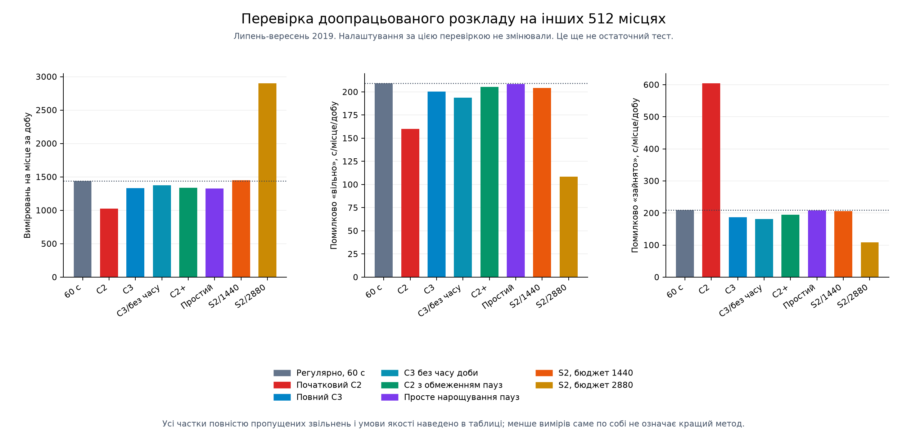

# Доопрацювання фази 3: діагностика, C3 та перевірка перенесення

Дата: 18.10.2026. Версія `phase3-refinement-C3-v1`. Попередній негативний результат [фази 3](phase3-method-report.md) збережено. **Остаточний тест на 867 місцях не запускався.**

**Повний C3 із часом доби не пройшов обидві додаткові перевірки через пропуски звільнень від хвилини. Його не залишаємо основним кандидатом.**

Водночас перевірку пройшли такі зафіксовані до її запуску варіанти:

- **C3 без часу доби:** скорочення на 4.61% у вікнах від 7 діб і на 3.46% у вікнах від 1 доби; обидві помилки не вищі за хвилинне правило, M60=0 на обох перевірках.
- **Просте нарощування пауз:** скорочення на 7.97% у вікнах від 7 діб і на 7.48% у вікнах від 1 доби; обидві помилки не вищі за хвилинне правило, M60=0 на обох перевірках.

Це додаткові результати розроблення. Варіант без часу доби та просте правило не оголошуються заднім числом єдиним початково обраним основним методом. Жодну таблицю після перевірки не переналаштовували.

## Чому змінюємо правило

Діагностика попередньої точки C2 на 128 місцях показала: із 31,409 пропущених звільнень-повторів від хвилини 31,259 виникли після останнього виміру «зайнято», 150 - після «вільно». Усі сталися за пауз 120 або 300 секунд. Повтор тут означає той самий епізод за іншого початку розкладу, а не нову фізичну подію. Діагностичні лічильники окремо перевірені зіставленням із незалежним симулятором.

Отже, змінено конкретні складові. Після виміру «зайнято» C3 може призначати лише 15, 30, 45 або 60 секунд. Після «вільно» доступні також 75, 90 і 120 секунд. Межа для одного останнього стану сама по собі не гарантує нуль пропусків: за довгої паузи після «вільно» також можливі кілька невидимих переходів. Тому всі пропуски далі рахуються повністю, як передбачено протоколом.

Друга зміна - спосіб навчання. C2 оцінював локальний ризик окремої паузи, а потім збирав із таких рішень розклад. C3 оцінює **весь розклад** повторним відтворенням навчальної історії. Після кожної пробної зміни таблиці заново враховуються всі викликані нею моменти перевірок і спостережувана історія. Справжній момент переходу не стає вхідною ознакою.

Причинне планування вже вивчається у [S2](https://doi.org/10.1109/TCOMM.2022.3160563); пошук політики з обмеженнями також не є новою загальною ідеєю, див. [S10](https://proceedings.mlr.press/v70/achiam17a.html). Наш скінченний пошук не відтворює CPO і не має його гарантій. Кандидат на прикладний внесок - конкретне правило для цієї паркувальної постановки та результати його перевірки. [Джерела й межі використання](phase3-refinement-sources.md).

## Навчання та вибір

До навчання збережено [план](phase3-refinement-plan.json), код і точні списки місць. Власні таблиці навчаються на січні-червні 256 місць із `train_development`, вибраних за хешем ідентифікатора; по три спільні початки розкладу, вікна від семи діб. Нову навчальну історію зарезервованих місць не відкривали.

Контекст містить ті самі 48 комбінацій останнього стану, часу доби та спостережуваної тривалості. Початкова таблиця - всюди 60 секунд. Покоординатний перебір робить не більше двох проходів та мінімізує C/C60 + λF·F/F60 + λO·O/O60, відкидаючи будь-яку таблицю з додатковим навчальним M60. Для λF і λO взято 0.25, 1, 4; після навчання перевірено межі паузи «вільно» 75, 90, 120 секунд. Є варіанти без часу доби й без спостережуваної тривалості. Разом 81 конфігурацій; 4914 навчальних відтворень. Це пошук кандидата, а не доказ оптимальності.

Остаточний вибір усередині кожного варіанта зроблено на тих самих 128 місцях липня-вересня, які вже використовувалися для розроблення. Збережено початкові вимоги F≤F60, O≤O60, M60≤M60_60 і відбір за мінімумом перевірок; додатково конфігурація має проходити їх на навчанні. **Умови не послаблювали.** Обрано `C3_full_0.25_0.25_90`: на початкових 128 місцях зменшення перевірок 8.01%, F=218.29, O=199.06 с/місце/добу, M60=0. Конфігурацію зафіксовано до читання результатів інших 512 місць.

Щоб перевірити, чи потрібен складніший спосіб навчання, до нової перевірки також зафіксовано [два додаткові контролі](phase3-refinement-comparators.json): C2 із межами пауз та просте нарощування паузи після послідовних однакових вимірів. Їхні параметри теж вибрано тільки на початкових 128 місцях. Зміни C2-C3 включають навчання, межі пауз та сітку дій; це не чиста перевірка однієї складової. Контролі потрібні саме для обмеження надто широких висновків.

## Додаткова перевірка: інші 512 місць

Після фіксації вибору виконано один запланований запуск на 512 інших місцях липня-вересня, виключивши початкові 128 і всі місця з раніше прочитаного префікса. Їх не добирали за успішністю алгоритму. Таблиці після результатів цієї перевірки не змінювалися. Це додаткова перевірка розроблення, а не остаточний жовтень-грудень.

Джерело всіх даних - [City of Melbourne, On-street Car Parking Sensor Data - 2019, S5](https://data.melbourne.vic.gov.au/explore/dataset/on-street-car-parking-sensor-data-2019/information/). Числа нижче - власні обчислення. Вікна від 7 діб: 1813; вікна від 1 доби: 6448. Другий набір містить перший та додаткові коротші вікна, тому ці перевірки не є незалежними одна від одної.

F/O - секунди неправильного показу на місце за добу. M60 - частка повністю пропущених звільнень від 60 секунд. «Умови» означає всі три вимоги якості одночасно; додатне скорочення перевірок саме по собі недостатнє.

| Метод, вікна від 7 діб | Перевірок/добу | Скорочення | F | O | M60 | Умови |
|---|---:|---:|---:|---:|---:|---|
| Регулярно, 60 с | 1440.03 | 0.00% | 209.29 | 209.25 | 0.00000% | так |
| Початковий C2 | 1025.91 | 28.76% | 159.95 | 604.32 | 6.33883% | ні |
| Повний C3 | 1332.61 | 7.46% | 200.43 | 186.23 | 0.00075% | ні |
| C3 без часу доби | 1373.66 | 4.61% | 193.72 | 181.28 | 0.00000% | так |
| C2 з обмеженням пауз | 1337.14 | 7.15% | 205.24 | 194.71 | 0.00000% | так |
| Просте нарощування пауз | 1325.25 | 7.97% | 208.71 | 208.42 | 0.00000% | так |
| S2, бюджет 1440 | 1451.07 | -0.77% | 204.23 | 205.56 | 0.06562% | ні |
| S2, бюджет 2880 | 2900.69 | -101.43% | 108.39 | 108.42 | 0.00000% | так |

| Метод, вікна від 1 доби | Перевірок/добу | Скорочення | F | O | M60 | Умови |
|---|---:|---:|---:|---:|---:|---|
| Регулярно, 60 с | 1440.07 | 0.00% | 253.71 | 253.58 | 0.00000% | так |
| Початковий C2 | 1124.17 | 21.94% | 182.06 | 694.47 | 6.26094% | ні |
| Повний C3 | 1345.04 | 6.60% | 239.71 | 222.93 | 0.00056% | ні |
| C3 без часу доби | 1390.18 | 3.46% | 230.83 | 216.15 | 0.00000% | так |
| C2 з обмеженням пауз | 1347.20 | 6.45% | 245.99 | 233.95 | 0.00006% | ні |
| Просте нарощування пауз | 1332.38 | 7.48% | 249.81 | 253.23 | 0.00000% | так |
| S2, бюджет 1440 | 1449.78 | -0.67% | 247.64 | 249.09 | 0.06570% | ні |
| S2, бюджет 2880 | 2898.22 | -101.26% | 132.35 | 131.72 | 0.00000% | так |

[CSV з усіма порогами тривалості](phase3-refinement-results.csv), [векторний рисунок](figures/phase3-refinement-fresh-check.svg). Джерело даних - S5; обчислення й рисунок авторські. Адаптація S2 використовує незмінні навчальні переходи з фази 3; її фактична частота може відрізнятися від номінальної.

## Розкид і перевірки

Для C3 відносно регулярних 60 секунд на вікнах від 7 діб обчислено парні 95% процентильні інтервали за 2000 повторними вибірками паркомісць: скорочення перевірок [6.99, 7.91]%, різниця F [-11.25, -6.57], різниця O [-25.39, -20.93] с/місце/добу. Усі вікна та десять початків одного місця залишаються разом. Ці інтервали не перетворюють перевірку розроблення на незалежний остаточний тест і не доводять еквівалентність якості.

Для варіантів, що пройшли обидві перевірки, ті самі інтервали:

- C3 без часу доби: скорочення перевірок [4.13, 5.09]%, різниця F [-18.68, -12.54], різниця O [-30.81, -25.35] с/місце/добу.
- Просте нарощування пауз: скорочення перевірок [7.6, 8.32]%, різниця F [-2.36, 1.14], різниця O [-1.26, -0.42] с/місце/добу.

Якщо в даних немає жодного пропуску, нульовий інтервал повторного вибирання не доводить неможливість пропусків у майбутньому. Порівняння спирається на записані стани сенсорів; їхню фізичну точність на нашому обладнанні не перевірено. Вимірювання енергії та батарейних відсотків у цих результатах немає.

**Пройшли 39 перевірок**, включно з новими паузами 45/75/90 секунд, правильністю діагностики, виключенням ознак і навчального обмеження M60. [Протокол](phase3-refinement-verification.json). Код попередньої фази та її негативні результати збережено; нові файли мають окрему версію. [Поточний реєстр](phase3-refinement-lock.json) містить контрольні суми моделей, вибору до перевірки, даних, коду й результатів.

## Рішення

Повний C3 із часом доби не пройшов обидві додаткові перевірки через пропуски звільнень від хвилини. Його не залишаємо основним кандидатом. Додаткові контролі показують, чи пояснює результат уже саме обмеження довгих пауз або простіше правило. Числа цих контролів не приховуються навіть тоді, коли вони кращі за C3. Перевага складнішого навчання й світова новизна не випливають із факту його реалізації.

У фазу 4 доцільно передати **всі вже зафіксовані варіанти, що пройшли перевірки**, та прості й літературні бази. Не вибирати за остаточним тестом нові параметри. C3 без часу доби має інший компроміс помилок і частоти, ніж просте нарощування пауз, тому саме остаточне порівняння потрібне для висновку про практичну користь навчання. До нього некоректно обіцяти перевагу складнішого варіанта.

**За підсумками розроблення основним кандидатом для фази 4 обрано C3 без часу доби**, а просте нарощування пауз залишено обов'язковим контролем. Це вибір після додаткової перевірки, до остаточного тесту; він явно зафіксований у [phase4-entry-lock.json](phase4-entry-lock.json). Навчені паузи після перевірки не змінювалися. На додаткових даних у C3 без часу доби нижчі обидві помилки, тоді як у простого правила менше вимірів; це різні точки компромісу. Для простого правила інтервал різниці F містить невелике погіршення, тому рівність якості не доведена.

Його точна навчена таблиця стискається до трьох рядків без зміни жодного рішення:

| Час від початку послідовності однакових вимірів | Після «вільно» | Після «зайнято» |
|---|---:|---:|
| До 5 хвилин | 30 с | 30 с |
| Від 5 до 15 хвилин | 45 с | 60 с |
| Від 15 хвилин | 75 с | 60 с |

Це спостережувана послідовність, а не відомий безперервний фізичний стан. Збережено [точну конфігурацію](phase3-refined-policy.json) та окрему функцію вибору паузи у коді; її еквівалентність навченій таблиці перевірено. Тут немає припущення про пропуски ультразвукового відбиття.

Основний Google-документ, Canva, прошивка й API не змінювалися. Подальша зміна після цієї перевірки потребує нової позначеної версії. Остаточні 867 місць залишено для фази 4.
