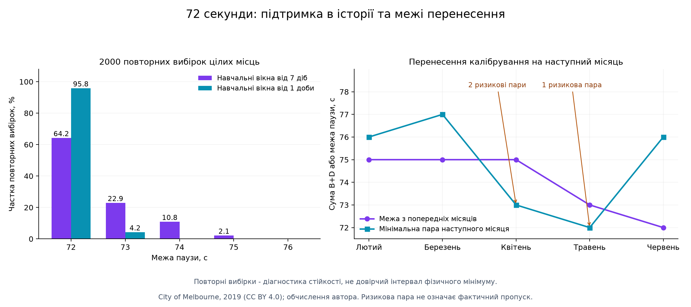
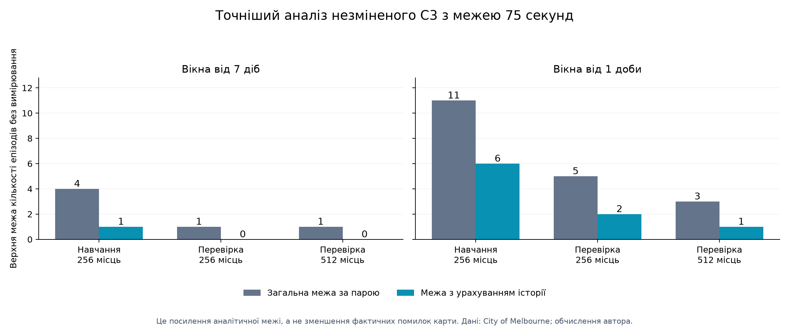

# Фаза 3: стійкість C4 та уточнення авторського внеску

Дата: 25.10.2026. Ідентифікатор: `parking-stability-audit-20261025`. Цей звіт уточнює [попередню оцінку C4](phase3-novelty-audit.md), не змінюючи її сирі результати. Основний Google-документ, презентації, прошивка та остаточні 867 місць не змінювалися й не оцінювалися.

**Висновок:** C4/72 не підтверджено як краще дослідницьке ядро порівняно з C3/75. Число 72 визначається рідкісними записами, а суцільний перебір зсувів не виявив переваги C4 за кількістю неспостережених хвилинних епізодів. Отримано корисне окреме посилення аналітичної межі з урахуванням історії. Його не видаємо за новий алгоритм із доведеною перевагою над літературою. **Фаза 4 залишається закритою.**

## 1. Що перевіряли

До запуску зафіксовано [план стійкості](phase3-stability-plan.json). Попередні результати навчання та перевірок уже були відомі. Використано ті самі 256 навчальних BayId за січень-червень і дві розробницькі групи 256/512 BayId за липень-вересень. Остаточну вибірку не відкривали; жодне нове число не називаємо остаточним сліпим тестом.

Окремий [план уточнення межі](phase3-history-bound-plan.json) записано після отримання результату суцільного перебору. Це чесно позначене аналітичне продовження, а не гіпотеза, нібито зафіксована до всіх цих результатів. Політики C3/C4, їхні пороги і ваги не переналаштовували.

Джерело станів: [City of Melbourne, On-street Car Parking Sensor Data - 2019](https://data.melbourne.vic.gov.au/explore/dataset/on-street-car-parking-sensor-data-2019/information/), CC BY 4.0. Обчислення авторські; записані інтервали не є незалежною фізичною розміткою. Час - локальні цивільні позначки, не підтверджений UTC.

## 2. Від чого залежить число 72

| Навчальні вікна | Повних пар з D>=60 | Пар із мінімумом 72 | Місць, які підтримують мінімум | Найбільша межа після вилучення однієї пари |
|---|---:|---:|---:|---:|
| Від 7 діб | 132840 | 1 | 1 | 73 с |
| Від 1 доби | 301347 | 3 | 3 | 72 с |

У головній навчальній вибірці це один запис на місці **2268**, 2019-05-20 08:37:24: записана зайнятість тривала **12 с**, наступний вільний епізод - **60 с**. Сума - 72 с. Вилучення цієї пари, її місця або її вікна змінює навчальну межу на 73 с. Це не підстава видаляти запис як «поганий»: причини короткої сенсорної зайнятості незалежно не перевірено.

У ширшій навчальній історії від 1 доби значення 72 підтримують три місця: 2268, 5584, 7885. Таким чином, у ширшому наборі підтримка краща, проте число все одно не стає фізичною нижньою межею майбутніх подій.

У 2000 повторних вибірках цілих місць із поверненням головний навчальний мінімум зберігся в **1283/2000 = 64.15%** випадків. Інші результати - від 73 до 76 с. Для ширшої історії 72 с зберігається в **1916/2000 = 95.80%** випадків. Це діагностика впливу вибору місць; її не називаємо довірчим інтервалом справжнього мінімуму. Епізоди всередині місця не вважаємо незалежними.



## 3. Чи переноситься мінімум на наступний місяць

Для кожного префікса використано тільки повні пари, що завершилися строго до межі наступного місяця. Наступний місяць не впливав на значення межі. Усічені на календарній межі пари виключено. Використано початково відібрані вікна від 7 діб, а не новий відбір за результатом місяця.

| Навчальна історія | Межа, с | Місяць наступної перевірки | Найменша наступна пара, с | Пар нижче попередньої межі |
|---|---:|---:|---:|---:|
| До кінця 1-го місяця | 75 | 2 | 76 | 0 |
| До кінця 2-го місяця | 75 | 3 | 77 | 0 |
| До кінця 3-го місяця | 75 | 4 | 73 | 2 |
| До кінця 4-го місяця | 73 | 5 | 72 | 1 |
| До кінця 5-го місяця | 72 | 6 | 76 | 0 |

Після січня-березня межа була 75 с; у квітні з'явилися дві коротші пари. Після квітня межа стала 73 с; у травні з'явилася пара 72 с. Це безпосередній приклад того, що мінімум минулої історії може не залишитися мінімумом наступної. Додатний лічильник означає втрату нульової аналітичної межі, а не встановлений фактичний пропуск політики.

Це перевірка **калібрування межі**, а не послідовний прогнозний тест усього C3: його початкові 30/45-секундні кроки раніше навчалися на всьому січні-червні. Такий тест не підміняємо неправдивим «навчалися тільки до кожного місяця».

## 4. Гіпотетична неточність часових меж

Якщо кожна межа записаного стану могла б мати похибку до `delta` с зі збереженням порядку станів, то реальна сума двох послідовних тривалостей не менша за `S_recorded-2*delta`. Для реального епізоду від хвилини записана вільна тривалість може бути від `60-2*delta`. Порахуємо кандидати, які після такого розширення можуть порушити умову для незмінних 72 с.

| Історія | delta=0 | delta=1 с | delta=2 с | delta=5 с |
|---|---:|---:|---:|---:|
| Навчання, 7 діб | 0 | 8 | 34 | 187 |
| Навчання, 1 доба | 0 | 24 | 98 | 623 |
| Перевірка 256, 1 доба | 0 | 9 | 61 | 446 |
| Перевірка 512, 1 доба | 0 | 22 | 79 | 572 |

Це умовний аналіз чутливості, а не виміряна похибка Melbourne або нашого пристрою. Позитивний лічильник не означає, що всі ці зміщення справді можливі одночасно чи що пропуски обов'язково стануться. Результат показує, що гарантію для точних записаних секунд не можна автоматично переносити на неточні фізичні часові межі.

## 5. Суцільна перевірка початкових зсувів

Загальна межа `B+D<75` залишала лише **8 повних вікон**, на яких C3 теоретично міг мати хвилинний епізод без вимірювання. На решті вікон відсутність таких епізодів уже випливає з нульової загальної межі. На кожному з цих восьми вікон відтворено незмінні C3/75 і C4/72 за **всіх 3600 цілих початкових зсувів від 0 до 3599 с**.

| BayId | Вікно від 7 діб | Загальних ризикових пар | Зсувів із M60>0, C3 | Зсувів із M60>0, C4 |
|---:|---|---:|---:|---:|
| 982 | ні | 1 | 0 | 0 |
| 2899 | ні | 1 | 0 | 0 |
| 5166 | так | 1 | 0 | 0 |
| 5612 | ні | 1 | 0 | 0 |
| 5710 | ні | 1 | 0 | 0 |
| 1320 | ні | 1 | 0 | 0 |
| 2746 | так | 1 | 0 | 0 |
| 5608 | ні | 1 | 0 | 0 |

Разом **57600 відтворень вікна-політики**, і в обох правилах M60=0. Для C3 не знайдено реального записаного прикладу пропуску в цій області стартів. Отже, стверджувати «C4 прибрав пропуски, які робив C3» не можна. C4 витрачає більше вимірів; зниження окремих F/O з попереднього звіту не скасовує цього компромісу.

Область перебору - перша година від початку кожного вікна. Для цілих часових меж, цілих пауз і правила без часу доби будь-який дробовий зсув усередині однієї секунди дає ту саму послідовність прочитаних станів: дробова частина не змінюється, а різниці між моментами вимірювань цілі. Це пояснює повноту секундної сітки в цій моделі; не поширюємо її на довільний старт у будь-який день вікна, інші політики або неточні часові позначки.

## 6. Що вдалося посилити аналітично

Довга пауза C3 можлива лише після 900 с однакових показів. Зайнятий інтервал тривалістю від 75 с мусить потрапити хоча б в одне вимірювання; після виявлення зайнятості 60-секундне обмеження змушує отримати зайнятий показ не раніше ніж за 60 с до його кінця. Це обмежує можливий вік наступної спостереженої вільної послідовності.

Отримано додаткову необхідну умову `p-r>A`, яку можна застосувати разом з `B+D<G`. [Припущення й повне доведення](phase3-history-bound-method.md). Це аналіз повноти спостереження, а не новий спосіб читати прихований стан без виміру.

| Історія | Загальна верхня межа | Верхня межа з історією |
|---|---:|---:|
| training256_primary_7_days | 4 | 1 |
| training256_sensitivity_1_day | 11 | 6 |
| check256_primary_7_days | 1 | 0 |
| check256_sensitivity_1_day | 5 | 2 |
| check512_primary_7_days | 1 | 0 |
| check512_sensitivity_1_day | 3 | 1 |



На основних перевірочних вікнах обох груп отримано нуль і для C3/75. Отже, тут аналітичне обґрунтування вже не потребує 72 с. На коротших вікнах залишаються 2 та 1 потенційні епізоди; нуль у переборі першої години не перетворює цю додатну межу на нуль для довільного старту.

Це підтверджене посилення **нашої попередньої аналітичної оцінки**. Не називаємо його автоматично вдосконаленням літературного алгоритму або фактичної точності системи.

## 7. Уточнення змісту M60

M60 рахує вільні епізоди від хвилини без вимірювання всередині. За обмеження пауз після «зайнято» до 60 с такий неспостережений епізод не може весь час показуватися зайнятим: попередній утримуваний показ мусить бути «вільно». Це вже випливає з доведення C4.

Тому M60 - показник **покриття епізодів актуальними вимірами**, а не безпосередньо кількість вільних місць, які водієві помилково не показали. Для точності карти безпосередні метрики - F та O. Їх не підміняємо новою назвою M60. Вимогу мати свіже підтвердження кожного хвилинного звільнення можна задати окремо; її практичну необхідність і саме число 60 с ще не доведено зовнішнім джерелом.

Це не зміна старих лічильників задля кращого результату: старе визначення збережено. Уточнюється тільки те, які твердження цей лічильник справді підтримує.

## 8. Внесок і рішення щодо подальшої роботи

Повні результати та межі читання джерел наведено в [оновленому зіставленні](phase3-stability-sources.md). S12 і S13 тепер опрацьовано до кінця основного тексту; S11 залишається доступним лише в анотації. Причинне планування, історія, пропущені події, мінімальні тривалості й оптимізація з обмеженнями вже відомі. Саме їх поєднання або відсутність знайденого однакового коду не доводять новизни.

**C4/72 не закріплюємо як головну авторську новизну.** Його позитивні числа реальні, але обґрунтування через рідкісний мінімум і відсутня перевага за M60 роблять сильну заяву необґрунтованою. Напрям адаптивного планування вимірювань залишається; основний текст магістерської зараз не переписуємо.

Точний наявний самостійний результат можна сформулювати так:

> Уточнено аналітичну верхню межу кількості вільних епізодів без вимірювання для розкладів із короткими початковими паузами. Крім тривалостей послідовних станів, ураховано обмеження віку спостереженої послідовності, що випливає з обов'язкового спостереження достатньо тривалої зайнятості. Показано, на яких записаних історіях це посилює обґрунтування повноти вимірювань без зменшення максимальної паузи.

Це кандидат на вузький аналітичний внесок, а не встановлена світова новизна нового алгоритму. За вимоги саме покращеного алгоритму планування ця частина ще не завершена. Потрібно оцінити достатність такого внеску для вимог магістерської та, якщо необхідне алгоритмічне поліпшення, спочатку зафіксувати конкретний недолік найсильнішого аналога й перевіряти зміну саме цього недоліку. Запуск остаточного тесту не замінює цієї роботи. [Умова переходу](phase3-novelty-gate.json) залишається закритою.

## 9. Перевірки й відтворення

Пройшли **70 перевірок**: старі 59 та нові перевірки впливу мінімуму, часового поділу, похибок меж, повного перебору, уточненого доведення й різниці між покриттям та показом стану. [Протокол](phase3-stability-verification.json). Старі протоколи не переписано.

```powershell
python research/parking_sampling/stability_audit.py
python research/parking_sampling/assess_history_certificate.py
python research/parking_sampling/verify_stability.py
python research/parking_sampling/build_stability_report.py
python research/parking_sampling/verify_stability_artifacts.py
```

Сирі дані діагностики, вплив кожного місця, часові префікси й усі масиви 3600 зсувів збережено в `.codex-work/parking-stability-audit-20261025/`. Графіки доступні у PNG/SVG; попередні докази й результати збережено з історією версій.
