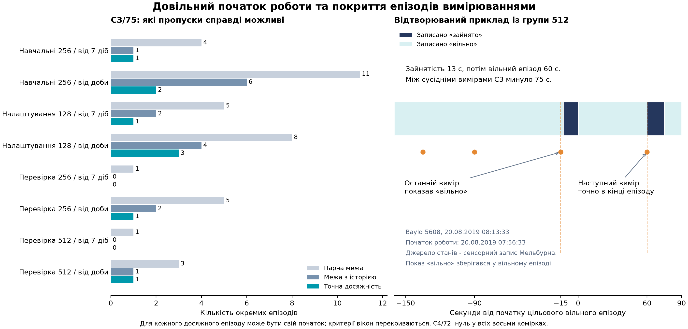

# Точна перевірка C3/C4 за всіх моментів початку роботи

25.10.2026. Фаза 3. [План](phase3-start-reachability-plan.json), [виведення й припущення](phase3-start-reachability-method.md), [таблиця](phase3-start-reachability-counts.csv), [конкретні старти](phase3-start-reachability-witnesses.csv).

**Для C3 знайдено можливі пропуски, яких не виявляв попередній перебір початкових зсувів на перевірочних групах.** Вони відтворюються, якщо почати роботу пізніше у відомому вікні. Це не змінює результат попереднього досліду: він перевіряв старти лише в межах першої години. Нове питання ширше: довільний початок у межах усього вікна з початковим виміром і скиданням спостереженого віку.

На тих самих даних C4/72 має нуль для всіх цільових епізодів і всіх початків за припущень методу: у жодної допустимої пари B+D немає значення меншого за 72 с. Це підтвердження на записі, а не гарантія для майбутніх фізичних паркувань.

## Що саме перевірено

Точний етап розглядає всі можливі виміри, які могли б оточувати ризиковий епізод, і встановлює досяжність потрібної історії показів. За цілих меж джерела та цілих пауз запуск із дробовою частиною часу має те саме покриття, що цілий запуск. Тому область охоплює також дійсні моменти старту; це випливає з доведення, а не лише з перевірки двох дробових зсувів.

Використано незмінені C3/75 і C4/72, навчальні 256, налаштовувальні 128 та вже відомі перевірочні 256/512 місць; окремо від 7 діб та від доби. Нових груп і остаточних 867 місць не відкривали. Записані мітки часу є локальними цивільними секундами, не підтвердженим UTC.

## Результати для C3

| Група / вікна | Цільових епізодів | Парна межа | Рекурсивна межа | Точно досяжні епізоди |
|---|---:|---:|---:|---:|
| Навчальні 256 / від 7 діб | 133491 | 4 | 1 | 1 |
| Навчальні 256 / від доби | 304236 | 11 | 6 | 2 |
| Налаштування 128 / від 7 діб | 52166 | 5 | 2 | 1 |
| Налаштування 128 / від доби | 97419 | 8 | 4 | 3 |
| Перевірка 256 / від 7 діб | 101739 | 1 | 0 | 0 |
| Перевірка 256 / від доби | 192610 | 5 | 2 | 1 |
| Перевірка 512 / від 7 діб | 186468 | 1 | 0 | 0 |
| Перевірка 512 / від доби | 344067 | 3 | 1 | 1 |

«Точно досяжні» означає: **для кожного такого епізоду існує принаймні один початок із пропуском**. Це не число пропусків одного спільного запуску, не частота збоїв і не ймовірність. Критерій від доби включає вікна від 7 діб; рядки не незалежні. Усього збережено 9 рядків зі свідченнями, які відповідають 7 різним записаним епізодам. Частина епізодів уже була відома з попередніх перевірок, тому не називаємо всі 7 нововиявленими.

Точний етап уточнив консервативні додатні межі, наприклад навчальні 256/від доби: 6 потенційних за R.3, але лише 2 індивідуально досяжні для C3. Для перевірочних 256/від доби: 2 і 1. Перевірочні 512/від доби: є 1 досяжний епізод, хоча попередній перебір стартів першої години не давав пропусків. Нуль основних перевірочних вікон від 7 діб збережено.

## Незалежна перевірка та обчислювальний обсяг

Зворотний пошук зіставлено з незалежним прямим перебором кожного цілого старту на 486 п'ятиінтервальних траєкторіях і трьох коротких шаблонах:1458 випадків «траєкторія-шаблон». Додано 100 зафіксовано випадкових восьмиінтервальних траєкторій з тими самими трьома шаблонами. Разом 1758 випадків, 25527 цілих та 51054 дробових запусків. Множини досяжних епізодів збіглися. Це перевірка реалізації, окремо від письмового доведення.

Кожен додатний випадок на даних відтворено старим незалежним симулятором із зафіксованою таблицею політики; перевірено всі виміри до цілі та відсутність виміру всередині неї. Для 16 комірок «дані-правило» після проходу по записаних інтервалах знадобилося 58 кандидатів останнього виміру, 271 крок довгої стадії та 1378 запитів стану в точному етапі. Повний прохід по джерелу в ці лічильники не входить. Це не виміряний коефіцієнт прискорення над попереднім дослідом: вони мають різні області стартів.

[Технічний журнал](phase3-start-reachability-verification.json) містить тести й контрольні суми; попередні 95 тестів і результати збережено.

## Практичний зміст і внесок

Маємо конкретне доповнення до аналітичної межі: якщо вона додатна, для фіксованого правила можна отримати точну відповідь і відтворюваний контрприклад. Це знімає невизначеність між «верхня межа залишає ризик» і «такий запуск справді існує». Метод виявив обмеження попередньої перевірки початкових зсувів. Правила C3/C4 не переналаштовувалися.

Це дослідницький результат **перевірки адаптивних розкладів**. Нової переваги онлайн-планувальника за витратами чи F/O цим не встановлено. Загальна перевірка досяжності, дискретизація та генерація контрприкладів давно відомі; власним є наведене спеціальне зведення S.1-S.2 для шаблону пауз і його перевірка на цій постановці. [Зіставлення з первинними працями](phase3-analytic-sources.md) не доводить світової новизни конкретної формули.

У всіх знайдених прикладах останній показ до цільового звільнення був «вільно». Тому відсутність виміру в епізоді не дорівнює цілком неправильному показу карти. Для наведеного BayId5608 пропущено коротку зайнятість 13 с, а карта у наступні 60 с вільного епізоду залишалася вільною. Мета свіжого підтвердження епізоду потребує окремого обґрунтування; поліпшення точності карти з цих чисел не випливає.

Джерело: [City of Melbourne2019](https://data.melbourne.vic.gov.au/explore/dataset/on-street-car-parking-sensor-data-2019/information/), CC BY4.0; це сенсорні записи. Фізична точність ультразвуку й споживання батареї тут не вимірювалися. Основний Google-документ і Canva не змінювалися. Фаза 4 залишається закритою: точний перевіряльник не підміняє незавершений критерій внеску поліпшеного планування та фіксацію остаточного протоколу.
