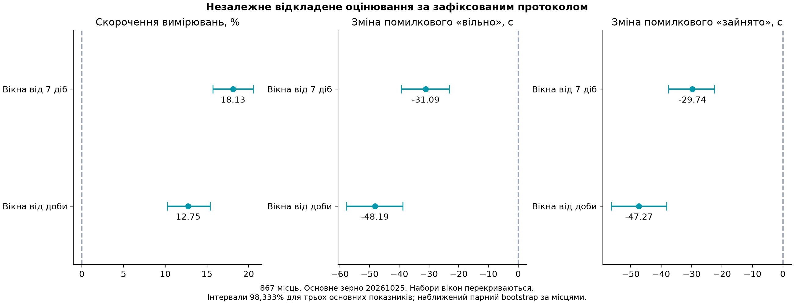

# Остаточне оцінювання розкладу вимірювань

Протокол [v0.2](phase4-display-protocol.md) і [фіксація до відкриття тесту](phase4-display-entry-lock.json). Числа та рішення не використовувалися для переналаштування методу.

Основний точковий критерій: **виконано**. Спільну інтервальну підтримку покращення трьох показників **отримано**. Ці два рішення показано окремо; навіть позитивний результат не доводить світової першості або універсальної переваги.

| Відомі вікна | Виміри: метод / щохвилини | Скорочення | F: метод / щохвилини | O: метод / щохвилини | Вільні епізоди від хвилини без виміру |
|---|---:|---:|---:|---:|---:|
| Вікна від 7 діб | 1179.0 / 1440.0 | 18.13% | 192.4 / 223.5 | 193.8 / 223.6 | 0.202% |
| Вікна від доби | 1256.4 / 1440.1 | 12.75% | 214.6 / 262.8 | 215.4 / 262.6 | 0.181% |

F/O - секунди на відому місце-добу. Обидва відбори використовують ті самі 867 місць, а їхні вікна перекриваються. M60 є наявністю нового виміру всередині вільного епізоду; він не дорівнює частці неправильних показів карти. Початковий протокол нульових пропусків збережено як окрему постановку.

[Повні лічильники, контрольні зіставлення, всі десять зерен, пропуски за п'ятьма тривалостями й індивідуальні погіршення](phase4-display-results.json), [таблиця CSV](phase4-display-results.csv). Не обирати інше зерно чи конкурента за цими результатами. Ретроспективне вирівнювання бюджету не використовується для основного висновку.

Навчальна історія місць - січень-червень, оцінювання - жовтень-грудень 2019. Спільні оцінки та ваги заморожено до читання тестових станів. Контролер бачить власні виміри; історія між ними використовується лише симулятором. Повторний відбір цілих місць зберігає внутрішні часові залежності, але не моделює просторову залежність між сусідніми місцями. Інтервали наближені й умовні щодо навчання. Правила відбору [зафіксовано до оцінювання](phase4-display-cohort.json).

Джерела методу й статистичних рішень наведено у [протоколі](phase4-display-protocol.md). Це відтворення відкритої сенсорної історії; споживання батареї та фізична точність ультразвуку тут не вимірювалися.
