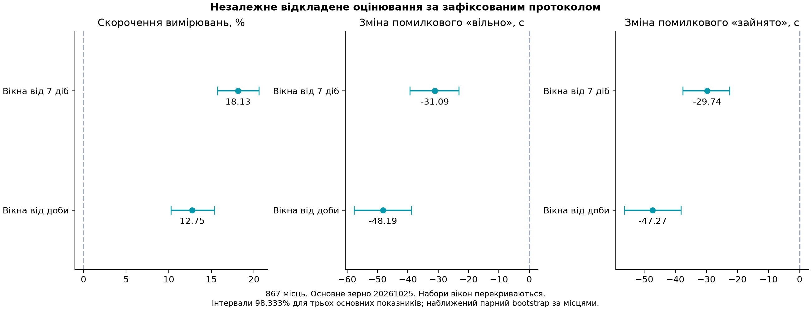
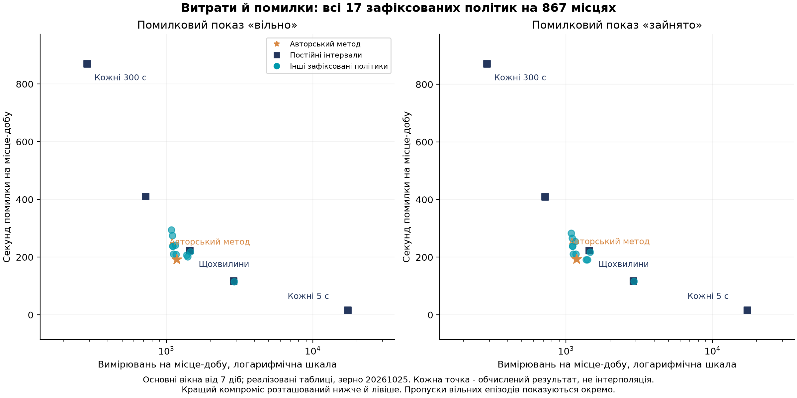
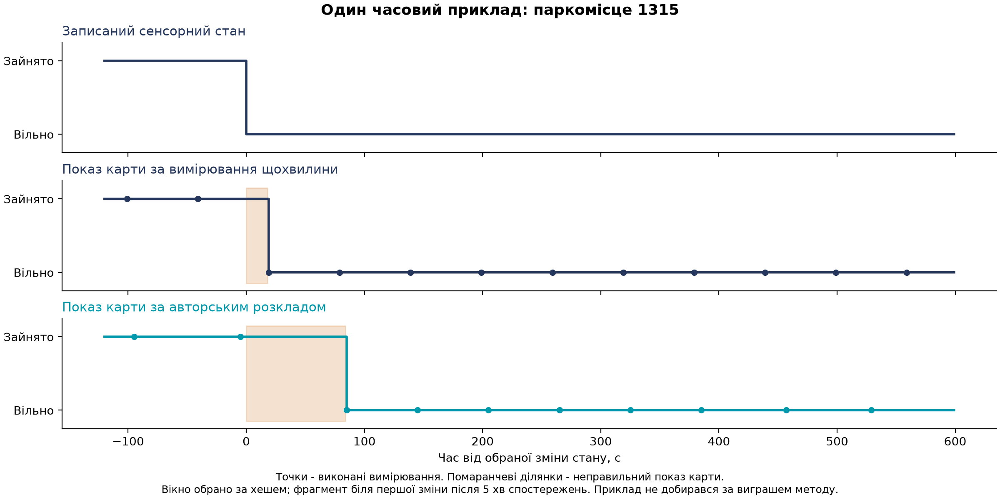

# Остаточний результат і три рисунки для захисту

Зафіксований метод перевірено на відкладених даних **867 паркомісць**. Основне оцінювання використовує відомі неперервні вікна від 7 діб за жовтень-грудень 2019. Параметри методу й правила висновку за цими результатами не змінювалися.

| Показник | Щохвилинне вимірювання | Авторський метод | Скорочення |
|---|---:|---:|---:|
| Вимірювань на місце-добу | 1440,03 | 1178,98 | **18,13%** |
| Помилковий показ «вільно», с/місце-добу | 223,50 | 192,41 | **13,91%** |
| Помилковий показ «зайнято», с/місце-добу | 223,55 | 193,81 | **13,30%** |

Це відносне скорочення кількості вимірів і часу помилок. Числа 13,91% та 13,30% не є приростом загальної точності у процентних пунктах. Енергію фізичного вузла тут не вимірювали.

## Основний результат та інтервали

Ліворуч додатне значення означає менше вимірювань. У двох інших панелях від'ємна різниця означає менший час помилки. На довгих вікнах це приблизно 31,09 с менше помилкового «вільно» та 29,74 с менше помилкового «зайнято» на місце-добу.

Основний точковий критерій і наперед заданий критерій спільної наближеної статистичної підтримки виконано. Інтервали отримані повторним парним відбором цілих місць; вони умовні щодо навчання та не моделюють окремо просторової залежності між місцями. Рядки від 7 діб та від доби перекриваються, тому не є двома незалежними експериментами.

## Витрати та якість різних методів

Кожна точка відповідає обчисленому результату зафіксованої політики. Лівіше - менше вимірювань, нижче - менше секунд помилки. Логарифмічна горизонтальна шкала дає змогу показати й часті вимірювання кожні 5 секунд, і довгі паузи. Ліній між точками та додаткових вигаданих проміжних експериментів немає.

Авторський метод має кращі три основні показники, ніж щохвилинне правило. Переваги над кожним іншим алгоритмом за всіма показниками не заявляємо. Наприклад, попередні C3/C4 мають трохи менший час помилкового «зайнято», але виконують більше вимірювань. Для решти зіставлень у [повній оцінці](phase4-assessment.md) наведено фактичні бюджети й обидва види помилок.

## Як утворюється помилка між вимірюваннями

Верхній рядок - записаний сенсорний стан, два нижні - показ карти за різними розкладами. Точки позначають вимірювання. Помаранчеві ділянки показують час, коли карта ще зберігала попередній стан після фактичного звільнення місця.

**У цьому фрагменті авторський розклад виявляє звільнення пізніше за щохвилинний.** Вікно обране за хешем, а фрагмент - біля першої зміни після п'яти хвилин спостережень. Приклад не добирався за виграшем. Він пояснює механізм помилки та відсутність гарантії поліпшення кожного окремого переходу. Загальний ефект оцінюється за всією зафіксованою вибіркою.

## Компроміс, який показуємо поряд із виграшем

Близько **0,202% вільних епізодів тривалістю від хвилини** не мають нового виміру всередині; щохвилинний контроль має нуль. Підрахунок включає десять спільних початкових фаз, тому чисельник 6562 не означає 6562 різні автомобілі. Ця метрика покриття епізодів не тотожна часу неправильного показу карти. Початкова вимога нульового M60 не виконана.

Поліпшення також нерівномірне: із 867 місць 353 мають більший особистий час помилкового «вільно», 328 - «зайнято». Обидва сукупні показники та середні з однаковою вагою місць поліпшені. Висновок стосується перевіреного компромісу для системи, а не гарантії кожному місцю.

Сенсорні записи опубліковано за ліцензією CC BY 4.0. [City of Melbourne, сенсорна історія 2019](https://data.melbourne.vic.gov.au/explore/dataset/on-street-car-parking-sensor-data-2019/information/).

[Протокол](phase4-display-protocol.md) · [Повні результати](phase4-display-results.json) · [Відтворення](../../delivery/README.md).
